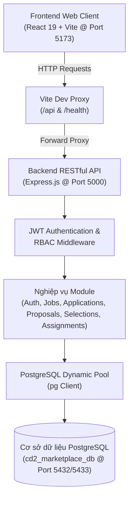
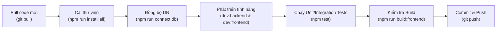

# JOBNEST — NỀN TẢNG QUẢN LÝ VIỆC LÀM PART-TIME & FREELANCE CHO SINH VIÊN

> **Đồ án Chuyên đề Tốt nghiệp 2**  
> **Khoa Công nghệ Thông tin — Trường Đại học Văn Lang (VLU)**  
> **Mã học phần:** 242_71ITBS40103_01  
> **Giảng viên hướng dẫn:** ThS. Nguyễn Văn Trung  
> **Kho lưu trữ GitHub chính thức:** [https://github.com/chinguyen-mr/student-parttime-marketplace.git](https://github.com/chinguyen-mr/student-parttime-marketplace.git)

---

## MỤC LỤC TỔNG QUAN

1. [Tổng quan dự án (Project Overview)](#1-tổng-quan-dự-án-project-overview)
2. [Mục tiêu dự án (Project Goals)](#2-mục-tiêu-dự-án-project-goals)
3. [Tính năng chính (Main Features)](#3-tính-năng-chính-main-features)
4. [Các vai trò người dùng (User Roles)](#4-các-vai-trò-người-dùng-user-roles)
5. [Ngăn xếp công nghệ (Technology Stack)](#5-ngăn-xếp-công-nghệ-technology-stack)
6. [Kiến trúc hệ thống (System Architecture)](#6-kiến-trúc-hệ-thống-system-architecture)
7. [Kiến trúc cơ sở dữ liệu (Database Architecture)](#7-kiến-trúc-cơ-sở-dữ-liệu-database-architecture)
8. [Cấu trúc thư mục dự án (Repository Structure)](#8-cấu-trúc-thư-mục-dự-án-repository-structure)
9. [Yêu cầu hệ thống (System Requirements)](#9-yêu-cầu-hệ-thống-system-requirements)
10. [Cài đặt từ máy tính mới từ con số 0 (Installation From Scratch)](#10-cài-đặt-từ-máy-tính-mới-từ-con-số-0-installation-from-scratch)
11. [Tải mã nguồn dự án (Clone Repository)](#11-tải-mã-nguồn-dự-án-clone-repository)
12. [Cài đặt các gói thư viện (Install Dependencies)](#12-cài-đặt-các-gói-thư-viện-install-dependencies)
13. [Cấu hình biến môi trường (Environment Configuration)](#13-cấu-hình-biến-môi-trường-environment-configuration)
14. [Cài đặt và thiết lập PostgreSQL (PostgreSQL Installation)](#14-cài-đặt-và-thiết-lập-postgresql-postgresql-installation)
15. [Khởi tạo Cơ sở dữ liệu (Database Creation)](#15-khởi-tạo-cơ-sở-dữ-liệu-database-creation)
16. [Chạy Migration lược đồ bảng (Database Migration)](#16-chạy-migration-lược-đồ-bảng-database-migration)
17. [Nạp dữ liệu mẫu (Seed Data)](#17-nạp-dữ-liệu-mẫu-seed-data)
18. [Khởi chạy máy chủ Backend (Run Backend)](#18-khởi-chạy-máy-chủ-backend-run-backend)
19. [Khởi chạy ứng dụng Frontend (Run Frontend)](#19-khởi-chạy-ứng-dụng-frontend-run-frontend)
20. [Khởi chạy toàn bộ hệ thống (Run Full Application)](#20-khởi-chạy-toàn-bộ-hệ-thống-run-full-application)
21. [Kiểm tra trạng thái dịch vụ (Health Check)](#21-kiểm-tra-trạng-thái-dịch-vụ-health-check)
22. [Danh sách tài khoản thử nghiệm (Demo Accounts)](#22-danh-sách-tài-khoản-thử-nghiệm-demo-accounts)
23. [Tổng quan API Endpoints (API Overview)](#23-tổng-quan-api-endpoints-api-overview)
24. [Kiểm thử tự động (Testing)](#24-kiểm-thử-tự-động-testing)
25. [Đóng gói phân phối (Production Build)](#25-đóng-gói-phân-phối-production-build)
26. [Xử lý lỗi thường gặp (Troubleshooting)](#26-xử-lý-lỗi-thường-gặp-troubleshooting)
27. [Lưu ý an toàn & bảo mật (Security Notes)](#27-lưu-ý-an-toàn--bảo-mật-security-notes)
28. [Quy trình phát triển (Development Workflow)](#28-quy-trình-phát-triển-development-workflow)
29. [Quy trình làm việc với Git (Git Workflow)](#29-quy-trình-làm-việc-với-git-git-workflow)
30. [Danh mục tài liệu kỹ thuật liên quan (Documentation)](#30-danh-mục-tài-liệu-kỹ-thuật-liên-quan-documentation)
31. [Các giới hạn kỹ thuật đã biết (Known Limitations)](#31-các-giới-hạn-kỹ-thuật-đã-biết-known-limitations)
32. [Thông tin nhóm tác giả (Contribution / Team Information)](#32-thông-tin-nhóm-tác-giả-contribution--team-information)

---

## 1. TỔNG QUAN DỰ ÁN (PROJECT OVERVIEW)

**JOBNEST** là nền tảng sàn thương mại điện tử dịch vụ kết nối việc làm part-time, thời vụ và các gói dự án freelance chuyên biệt dành cho sinh viên Đại học Văn Lang và các trường đại học tại TP. Hồ Chí Minh. Nền tảng giải quyết bài toán tìm kiếm việc làm uy tín, minh bạch tiến độ làm việc, bảo vệ thù lao lao động của sinh viên thông qua quy trình giao việc có hợp đồng cam kết (*Work Assignment*) và hệ thống đánh giá hai chiều (*Two-way Review System*).

---

## 2. MỤC TIÊU DỰ ÁN (PROJECT GOALS)

- **Minh bạch thông tin việc làm:** Loại bỏ các tin tuyển dụng lừa đảo thông qua cơ chế kiểm duyệt tin 2 cấp (Hệ thống & Quản trị viên).
- **Hỗ trợ đa hình thức làm việc:** Tích hợp linh hoạt 3 nhóm hình thức: Việc bán thời gian cố định (*Part-time*), Việc dự án khoán gọn (*Freelance*), và Việc thời vụ sự kiện ngắn hạn (*Seasonal*).
- **Kiểm soát hợp đồng & tiến độ (Rule A3):** Tuyến chọn lọc ứng viên độc quyền nhằm chuyển đổi đơn ứng tuyển sang hợp đồng thực thi có thời hạn, tiến độ và sản phẩm bàn giao (*Deliverables*).
- **Bảo vệ quyền lợi đôi bên:** Quy trình nghiệm thu sản phẩm, giải quyết khiếu nại báo cáo vi phạm và đánh giá sao công khai sau khi công việc hoàn thành.

---

## 3. TÍNH NĂNG CHÍNH (MAIN FEATURES)

1. **Khám phá & Bộ lọc việc làm nâng cao (WF-G01, WF-G02):** Tìm kiếm theo từ khóa, ngành nghề, khoảng thù lao, địa điểm và bản đồ số Leaflet.
2. **Quy trình ứng tuyển Part-time & Báo giá Freelance (WF-S03, WF-S04):** Sinh viên nộp hồ sơ CV đính kèm thư giới thiệu hoặc nộp đề xuất báo giá dự án (Proposal) kèm thời gian cam kết.
3. **Quản lý tuyển dụng & Duyệt hồ sơ (WF-E03, WF-E04):** Nhà tuyển dụng theo dõi danh sách ứng viên, thay đổi trạng thái và thực hiện chấp thuận ứng viên (Selections).
4. **Hợp đồng & Nhật ký tiến độ công việc (WF-E05, WF-S05):** Quản lý tiến trình công việc theo máy trạng thái hữu hạn (FSM): `NOT_STARTED` $\rightarrow$ `IN_PROGRESS` $\rightarrow$ `COMPLETED`.
5. **Nghiệm thu bàn giao sản phẩm Freelance (WF-S06, WF-E06):** Sinh viên tải lên sản phẩm demo, nhà tuyển dụng duyệt nghiệm thu hoặc yêu cầu chỉnh sửa có phản hồi.
6. **Đánh giá hai chiều sau công việc (WF-E07, WF-S07):** Nhà tuyển dụng và sinh viên chấm điểm sao và nhận xét năng lực lẫn nhau.
7. **Trung tâm thông báo thời gian thực (WF-S08, WF-E08):** Thông báo biến động trạng thái đơn, hợp đồng và phản hồi báo cáo.
8. **Bảng điều khiển Quản trị viên (WF-A01 $\rightarrow$ WF-A08):** Giám sát KPI sàn, kiểm duyệt tin đăng, quản lý người dùng, xử lý báo cáo vi phạm và tra cứu nhật ký kiểm toán hệ thống.

---

## 4. CÁC VAI TRÒ NGƯỜI DÙNG (USER ROLES)

| Vai trò (Role) | Mô tả trách nhiệm | Quyền hạn chính |
|---|---|---|
| **STUDENT (Sinh viên)** | Tìm việc làm bán thời gian hoặc nhận dự án freelance | Tạo hồ sơ kỹ năng/học vấn, nộp đơn ứng tuyển, gửi proposal, cập nhật tiến độ, nộp sản phẩm, đánh giá đối tác. |
| **EMPLOYER (Nhà tuyển dụng)** | Doanh nghiệp, chuỗi cửa hàng hoặc cá nhân tuyển dụng | Đăng tin tuyển dụng, xem danh sách ứng viên/proposal, duyệt chọn ứng viên (tạo Work Assignment), nghiệm thu sản phẩm, đánh giá sinh viên. |
| **ADMIN (Quản trị viên)** | Ban điều hành hệ thống sàn JOBNEST | Duyệt/từ chối tin tuyển dụng, khóa tài khoản vi phạm, giải quyết báo cáo khiếu nại, xem thống kê KPI và nhật ký Admin Logs. |

---

## 5. NGĂN XẾP CÔNG NGHỆ (TECHNOLOGY STACK)

### Backend Service (`03_backend`)
- **Runtime Environment:** Node.js (phiên bản `>= 20.0.0`, kiểm thử thực tế trên Node v24).
- **Web Framework:** Express.js `4.21.2` (Kiến trúc phân tầng 3 lớp: Routes $\rightarrow$ Services $\rightarrow$ Repositories).
- **PostgreSQL Client:** `pg` `8.13.1` (Connection Pooling với cơ chế tự động dò cổng mạng và cấp lại kết nối động).
- **Xác thực & Bảo mật:** `jsonwebtoken` `9.0.3` (JWT RBAC), `bcryptjs` `3.0.3` (Mã hóa mật khẩu an toàn).
- **Kiểm thử tự động:** Node.js Native Test Runner (`node:test`, `node:assert/strict`) với **31/31 bài test tích hợp pass 100%**.

### Frontend Web Client (`04_frontend`)
- **Core Library:** React `19.3.1` + React DOM `19.3.1`.
- **Build Tool & Bundler:** Vite `8.3.4` (Hỗ trợ Hot Module Replacement & Rollup production build).
- **Giao diện & Biểu tượng:** `lucide-react` `1.61.0`, `motion` `14.9.0`, `@animate-ui/react` `2.4.1`.
- **Bản đồ số:** `leaflet` `1.9.4` (Hiển thị tọa độ địa điểm tuyển dụng).
- **Thiết kế giao diện:** CSS Design Tokens (Bảng màu nhận diện thương hiệu Soft Lavender `#7565A8` & Warm Peach `#F4B99D`).

### Cơ sở dữ liệu (Database)
- **Hệ quản trị CSDL:** PostgreSQL (>= 14.0, tương thích phiên bản 14, 15, 16, 17 và 18).
- **Lược đồ CSDL:** 30 bảng quan hệ, toàn vẹn ràng buộc khóa ngoại `CASCADE` và chỉ mục `INDEX` tối ưu truy vấn.

---

## 6. KIẾN TRÚC HỆ THỐNG (SYSTEM ARCHITECTURE)

Dự án áp dụng mô hình phân tách độc lập Client-Server (Decoupled Single Page Application & RESTful API):



---

## 7. KIẾN TRÚC CƠ SỞ DỮ LIỆU (DATABASE ARCHITECTURE)

Hệ thống bao gồm **30 bảng quan hệ** thuộc lược đồ `public`:

1. **Nhóm Xác thực & Người dùng:** `users`, `employer_profiles`, `student_profiles`, `student_skills`, `student_educations`, `student_experiences`, `student_cvs`, `verification_tokens`, `password_reset_tokens`.
2. **Nhóm Tin tuyển dụng:** `categories`, `jobs`, `part_time_details`, `freelance_details`, `seasonal_details`, `job_skills`, `job_views`, `job_saved`.
3. **Nhóm Ứng tuyển & Báo giá:** `applications`, `application_histories`, `freelance_proposals`, `proposal_histories`.
4. **Nhóm Hợp đồng & Tiến độ:** `work_assignments`, `work_deliverables`, `deliverable_reviews`, `work_progress`.
5. **Nhóm Tương tác & Quản trị:** `reviews`, `reports`, `report_actions`, `notifications`, `admin_logs`.

---

## 8. CẤU TRÚC THƯ MỤC DỰ ÁN (REPOSITORY STRUCTURE)

```text
Chuyên Đề 2/
├── 01_tailieu/                     # Hồ sơ đặc tả SRS, Use Case, đề cương đồ án
├── 02_database/                    # Tài liệu lược đồ CSDL & Migrations
│   ├── migrations/                 # 31 tập tin SQL DDL khởi tạo bảng
│   ├── seeds/                      # File nạp dữ liệu mẫu ban đầu (001_seed_data.sql)
│   ├── cd2_marketplace_full_dump.sql # Bản sao lưu toàn bộ cấu trúc & 133 users (~603 KB)
│   └── erd/                        # Sơ đồ quan hệ thực thể (.drawio)
│
├── 03_backend/                     # Mã nguồn máy chủ Backend API (Node.js + Express)
│   ├── src/
│   │   ├── config/                 # db.js, auto-bootstrap.js, migrate.js, seed.js
│   │   ├── middleware/             # auth.middleware.js, error.middleware.js
│   │   ├── modules/                # auth, jobs, applications, proposals, selections...
│   │   ├── app.js                  # Cấu hình Express app, CORS, routes
│   │   └── server.js               # Điểm khởi chạy máy chủ HTTP (Port 5000)
│   ├── tests/integration/          # 8 test suites kiểm thử tích hợp (31 tests)
│   ├── .env.example                # Biến môi trường mẫu cho Backend
│   ├── package.json
│   └── package-lock.json
│
├── 04_frontend/                    # Mã nguồn ứng dụng giao diện (React 19 + Vite)
│   ├── src/
│   │   ├── components/             # UI components dùng chung (Header, Footer, JobCard...)
│   │   ├── pages/                  # Phân hệ trang: admin/, employer/, student/, guest/
│   │   ├── services/               # api.js (kết nối tập trung & health check)
│   │   ├── App.jsx                 # Điều phối Root Layout & Tabs
│   │   └── main.jsx
│   ├── .env.example                # Biến môi trường mẫu cho Frontend
│   ├── vite.config.js              # Cấu hình Vite & API Proxy
│   ├── package.json
│   └── package-lock.json
│
├── 05_wireframes/                  # Danh mục 44 file HTML wireframe đối chiếu
├── docs/                           # Báo cáo kỹ thuật, ma trận kiểm toán, changelog
│   ├── README_ENVIRONMENT_AUDIT.md # Báo cáo kiểm định môi trường và thư viện
│   ├── README_SETUP_VERIFICATION.md# Báo cáo bằng chứng kiểm thử 13 hạng mục
│   ├── PROJECT_DOCUMENTATION_CHANGELOG.md # Nhật ký thay đổi đồng bộ tài liệu
│   └── PROJECT_SETUP_GAP_REGISTER.md     # Danh mục ghi nhận điểm rà soát kỹ thuật
│
├── setup_new_machine.bat           # Kịch bản 1-Click tự động cài đặt & kết nối cho máy mới
├── connect_db.bat                  # Kịch bản 1-Click kết nối CSDL PostgreSQL
├── connect_db.js                   # Công cụ CLI kết nối, quét port, tạo DB và nạp data
├── dump_database.js                # Công cụ xuất dữ liệu CSDL ra file SQL Dump
├── setup_temp_admin.js             # Công cụ khởi tạo/cập nhật tài khoản Admin Test
├── package.json                    # Cấu hình điều phối tổng thể toàn bộ dự án
└── README.md                       # Tài liệu hướng dẫn chính thức này
```

---

## 9. YÊU CẦU HỆ THỐNG (SYSTEM REQUIREMENTS)

- **Hệ điều hành:** Windows 10/11 (64-bit), macOS 12 Monterey trở lên, hoặc Linux Ubuntu 20.04+ LTS.
- **Node.js:** Phiên bản `>= 20.0.0` (Khuyến nghị bản LTS như **v20.x** hoặc **v22.x/v24.x**).
- **npm:** Phiên bản `>= 9.0.0` (Đi kèm sẵn khi cài đặt Node.js).
- **PostgreSQL Server:** Phiên bản `>= 14.0` (Được hỗ trợ tối ưu trên bản 15, 16, 17 hoặc 18).
- **Dung lượng ổ đĩa trống:** Tối thiểu **1.5 GB** (cho mã nguồn, `node_modules` và cơ sở dữ liệu).
- **RAM:** Tối thiểu 4 GB (Khuyến nghị 8 GB để chạy mượt cả Backend, Frontend và PostgreSQL).

---

## 10. CÀI ĐẶT TỪ MÁY TÍNH MỚI TỪ CON SỐ 0 (INSTALLATION FROM SCRATCH)

> 💡 **Dành cho ai?** Phần này hướng dẫn chi tiết dành riêng cho người vừa cài lại Windows hoặc nhận một máy tính hoàn toàn mới, chưa cài bất kỳ công cụ lập trình nào.

### Bước 1: Cài đặt Git
1. Tải bộ cài đặt Git chính thức cho Windows tại: [https://git-scm.com/download/win](https://git-scm.com/download/win).
2. Chạy tập tin `.exe` vừa tải về, bấm **Next** liên tục theo các tùy chọn mặc định để hoàn tất cài đặt.
3. Mở **PowerShell** hoặc **Command Prompt (CMD)** và kiểm tra:
   ```powershell
   git --version
   ```
   *Kết quả hợp lệ:* `git version 2.x.x`.

### Bước 2: Cài đặt Node.js và npm
1. Truy cập trang chủ chính thức của Node.js: [https://nodejs.org/](https://nodejs.org/).
2. Chọn phiên bản **LTS (Long Term Support)** và tải file cài đặt `.msi` (x64).
3. Mở file `.msi`, tích chọn đồng ý điều khoản, bấm **Next** cho đến khi hoàn tất.
4. Mở cửa sổ PowerShell mới và kiểm tra:
   ```powershell
   node -v
   npm -v
   ```
   *Kết quả hợp lệ:* `node: >= v20.0.0`, `npm: >= 9.x.x`.

### Bước 3: Cài đặt PostgreSQL Server & pgAdmin 4
1. Tải bộ cài đặt PostgreSQL chính thức cho Windows từ EnterpriseDB: [https://www.postgresql.org/download/windows/](https://www.postgresql.org/download/windows/).
2. Trong quá trình cài đặt:
   - **Components:** Giữ nguyên các tích chọn mặc định (*PostgreSQL Server*, *pgAdmin 4*, *Command Line Tools*).
   - **Password (RẤT QUAN TRỌNG):** Đặt mật khẩu cho tài khoản siêu quản trị `postgres` (Khuyến nghị đặt là `postgres` hoặc `123` hoặc ghi nhớ chính xác mật khẩu bạn đặt).
   - **Port:** Mặc định là `5432`. Bấm **Next** để hoàn thành.
3. Sau khi cài xong, mở hộp thoại `Windows + R`, gõ `services.msc`, kiểm tra xem dịch vụ tên `postgresql-x64-...` đã có trạng thái **Running** hay chưa.

---

## 11. TẢI MÃ NGUỒN DỰ ÁN (CLONE REPOSITORY)

Mở PowerShell hoặc Git Bash, di chuyển tới thư mục bạn muốn lưu dự án (ví dụ `D:\Projects` hoặc `C:\Users\<Tên_bạn>\Documents`) và chạy lệnh:

```powershell
git clone https://github.com/chinguyen-mr/student-parttime-marketplace.git
cd student-parttime-marketplace
```

*(Nếu không sử dụng Git, bạn có thể tải file ZIP trực tiếp từ GitHub, sau đó giải nén ra một thư mục trên máy).*

---

## 12. CÀI ĐẶT CÁC GÓI THƯ VIỆN (INSTALL DEPENDENCIES)

Từ thư mục gốc dự án, chạy lệnh duy nhất để tự động cài đặt toàn bộ `node_modules` cho cả Backend và Frontend:

```powershell
npm run install:all
```

*Lệnh trên tương đương với:*
```powershell
npm --prefix 03_backend install
npm --prefix 04_frontend install
```

> ⚠️ **Lưu ý:** Không xóa tập tin `package-lock.json` để đảm bảo phiên bản thư viện được cài đặt luôn đồng nhất trên mọi máy tính.

---

## 13. CẤU HÌNH BIẾN MÔI TRƯỜNG (ENVIRONMENT CONFIGURATION)

### 13.1. Cấu hình Backend (`03_backend/.env`)

Tạo tập tin `03_backend/.env` bằng cách sao chép từ file mẫu `03_backend/.env.example`:

```powershell
# Trên Windows PowerShell:
Copy-Item 03_backend\.env.example 03_backend\.env

# Trên Linux/macOS/Git Bash:
cp 03_backend/.env.example 03_backend/.env
```

Nội dung chi tiết trong `03_backend/.env`:
```env
PORT=5000
NODE_ENV=development

# Cấu hình kết nối PostgreSQL
DB_HOST=localhost
DB_PORT=5432
DB_USER=postgres
DB_PASSWORD=mật_khẩu_postgresql_trên_máy_của_bạn
DB_NAME=cd2_marketplace_db

# Khóa bí mật JWT
JWT_SECRET=supersecretjwtkey_marketplace_cd2_vlu_2026
JWT_EXPIRES_IN=7d
```

| Biến môi trường | Ý nghĩa | Giá trị mẫu | Bắt buộc |
|---|---|---|---|
| `PORT` | Cổng HTTP Server của Backend API | `5000` | Có |
| `NODE_ENV` | Môi trường vận hành (`development` / `production`) | `development` | Có |
| `DB_HOST` | Địa chỉ máy chủ CSDL PostgreSQL | `localhost` | Có |
| `DB_PORT` | Cổng kết nối PostgreSQL (mặc định 5432, một số máy là 5433) | `5432` | Có |
| `DB_USER` | Tên người dùng quản trị PostgreSQL | `postgres` | Có |
| `DB_PASSWORD` | Mật khẩu tài khoản PostgreSQL bạn đã đặt khi cài đặt | *Điền đúng mật khẩu của bạn* | Có |
| `DB_NAME` | Tên cơ sở dữ liệu của dự án | `cd2_marketplace_db` | Có |
| `JWT_SECRET` | Khóa bí mật dùng để ký và xác thực JWT token | *Chuỗi ký tự bảo mật* | Có |
| `JWT_EXPIRES_IN` | Thời hạn hiệu lực của token đăng nhập | `7d` | Có |

### 13.2. Cấu hình Frontend (`04_frontend/.env`)

Sao chép từ file mẫu `04_frontend/.env.example`:

```powershell
Copy-Item 04_frontend\.env.example 04_frontend\.env
```

Nội dung trong `04_frontend/.env`:
```env
# URL trỏ tới máy chủ Backend API
VITE_API_URL=http://localhost:5000/api
```

---

## 14. CÀI ĐẶT VÀ THIẾT LẬP POSTGRESQL (POSTGRESQL INSTALLATION)

Đảm bảo dịch vụ PostgreSQL đang hoạt động trước khi kết nối:

- **Kiểm tra trên Windows:**
  1. Nhấn `Windows + R`, gõ `services.msc` $\rightarrow$ Enter.
  2. Tìm dịch vụ có tên bắt đầu bằng `postgresql-x64-...`.
  3. Cột **Status** phải hiển thị là **Running**. Nếu chưa, click chuột phải $\rightarrow$ chọn **Start**.
- **Kiểm tra cổng 5432 bằng PowerShell:**
  ```powershell
  Test-NetConnection -ComputerName localhost -Port 5432
  ```
  Nếu `TcpTestSucceeded : True` nghĩa là cổng kết nối đã sẵn sàng.

---

## 15. KHỞI TẠO CƠ SỞ DỮ LIỆU (DATABASE CREATION)

### Cách A: Tự động hoàn toàn bằng kịch bản dự án (Khuyến nghị)
Bạn chỉ cần chạy công cụ tự động hóa từ thư mục gốc:
```powershell
npm run connect:db
```
*(Hoặc trên Windows: Click đúp vào file `connect_db.bat`)*. Công cụ này sẽ tự động phát hiện port, kiểm tra kết nối và tạo mới database `cd2_marketplace_db` nếu máy tính chưa có.

### Cách B: Tạo thủ công qua pgAdmin 4
1. Mở phần mềm **pgAdmin 4**, đăng nhập mật khẩu master.
2. Mở nhánh **Servers** $\rightarrow$ chọn PostgreSQL Server của bạn.
3. Click chuột phải vào **Databases** $\rightarrow$ chọn **Create** $\rightarrow$ **Database...**.
4. Ô **Database**, nhập chính xác: `cd2_marketplace_db`.
5. Bấm **Save**.

### Cách C: Tạo qua câu lệnh psql (Command Line)
```powershell
psql -U postgres -h localhost -p 5432 -c "CREATE DATABASE cd2_marketplace_db;"
```

---

## 16. CHẠY MIGRATION LƯỢC ĐỒ BẢNG (DATABASE MIGRATION)

Dự án cung cấp 31 tập tin SQL Migration chuẩn hóa trong thư mục `02_database/migrations/`.

- **Chạy tự động:**
  ```powershell
  npm run migrate
  ```
- **Thứ tự thực thi ưu tiên:**
  Hệ thống nạp theo thứ tự logic khóa ngoại: `users.sql` $\rightarrow$ `categories.sql` $\rightarrow$ `employer_profiles.sql` $\rightarrow$ `student_profiles.sql` $\rightarrow$ `jobs.sql` $\rightarrow$ `applications.sql` $\rightarrow$ `work_assignments.sql` $\rightarrow$ `reviews.sql` $\rightarrow$ `reports.sql` $\rightarrow$ `notifications.sql`.

---

## 17. NẠP DỮ LIỆU MẪU (SEED DATA)

Để có sẵn việc làm mẫu, hồ sơ sinh viên, đánh giá và 133 tài khoản người dùng thực tế:

### Lựa chọn 1: Nạp bản sao lưu đầy đủ qua pgAdmin 4 (Chuẩn xác 100%)
1. Mở **pgAdmin 4**, click chọn database `cd2_marketplace_db`.
2. Trên thanh công cụ, chọn **Tools** $\rightarrow$ **Query Tool**.
3. Bấm icon Mở File (📁 hoặc `Ctrl + O`), chọn file:
   ```text
   02_database/cd2_marketplace_full_dump.sql
   ```
4. Bấm nút **Play (Tam giác xanh ▶️)** hoặc phím **F5**. Toàn bộ 30 bảng và 133 users sẽ được nạp tức thì.

### Lựa chọn 2: Nạp dữ liệu mẫu ban đầu qua dòng lệnh
```powershell
npm run seed
```

---

## 18. KHỞI CHẠY MÁY CHỦ BACKEND (RUN BACKEND)

Mở một cửa sổ Terminal tại thư mục gốc dự án:

```powershell
npm run dev:backend
```

- **Cổng dịch vụ:** `http://localhost:5000`
- **Cơ chế:** Kích hoạt tính năng `Auto-Bootstrap`, tự kiểm tra kết nối CSDL, đồng bộ bảng nếu thiếu và lắng nghe HTTP requests.

---

## 19. KHỞI CHẠY ỨNG DỤNG FRONTEND (RUN FRONTEND)

Mở một cửa sổ Terminal **thứ hai** tại thư mục gốc dự án:

```powershell
npm run dev:frontend
```

- **Địa chỉ giao diện:** `http://localhost:5173`
- Mở trình duyệt Web (Chrome, Edge, Firefox) và truy cập đường dẫn trên để trải nghiệm giao diện người dùng.

---

## 20. KHỞI CHẠY TOÀN BỘ HỆ THỐNG (RUN FULL APPLICATION)

> 💡 **Khuyến nghị trên Windows:** Bạn có thể chạy nhanh toàn bộ các bước thiết lập lần đầu chỉ bằng một cú click đúp chuột vào file:
> ```text
> setup_new_machine.bat
> ```
> File sẽ tự động kiểm tra Node.js, chạy `install:all`, kết nối CSDL, nạp schema và tạo sẵn tài khoản Admin.

Sau đó, duy trì 2 cửa sổ terminal:
- **Terminal 1:** `npm run dev:backend` (Dịch vụ API cổng 5000)
- **Terminal 2:** `npm run dev:frontend` (Giao diện Web cổng 5173)

---

## 21. KIỂM TRA TRẠNG THÁI DỊCH VỤ (HEALTH CHECK)

Truy cập đường dẫn kiểm tra sức khỏe hệ thống:
```text
http://localhost:5000/health
```

- **Khi hoạt động bình thường (HTTP 200 OK):**
  ```json
  {
    "status": "ok",
    "db": "ok",
    "service": "cd2-marketplace-backend",
    "timestamp": "2026-11-04T15:00:00.000Z"
  }
  ```
- **Khi Cơ sở dữ liệu bị mất kết nối (HTTP 503 Degraded):**
  ```json
  {
    "status": "degraded",
    "db": "unhealthy: connect ECONNREFUSED 127.0.0.1:5432",
    "service": "cd2-marketplace-backend"
  }
  ```

---

## 22. DANH SÁCH TÀI KHOẢN THỬ NGHIỆM (DEMO ACCOUNTS)

Tất cả tài khoản thử nghiệm đều dùng mật khẩu chung: **`password123`**

| Vai trò (Role) | Email đăng nhập | Mật khẩu | Mục đích sử dụng |
|---|---|---|---|
| **ADMIN (Quản trị viên)** | `admin.test@vlu.edu.vn` | `password123` | Quản trị toàn quyền, duyệt tin tuyển dụng, xử lý báo cáo vi phạm, xem dashboard KPI |
| **ADMIN (Hệ thống)** | `admin@marketplace.vlu.edu.vn` | `password123` | Tài khoản quản trị khởi tạo từ dữ liệu mẫu Seed |
| **EMPLOYER (Doanh nghiệp IT)** | `techcorp@gmail.com` | `password123` | Đăng việc Freelance/Part-time, duyệt báo giá proposal, quản lý hợp đồng |
| **EMPLOYER (Chuỗi F&B)** | `coffeehouse@gmail.com` | `password123` | Đăng tin tuyển phục vụ, nhân viên pha chế part-time, chọn ứng viên |
| **STUDENT (Sinh viên IT)** | `nguyen.van.chi@vlu.edu.vn` | `password123` | Nộp đơn part-time, nộp proposal freelance, nộp sản phẩm nghiệm thu |
| **STUDENT (Sinh viên QTKD)** | `le.quang.tuan@vlu.edu.vn` | `password123` | Ứng tuyển công việc bán thời gian, đánh giá nhà tuyển dụng |

> 🔒 **Cảnh báo bảo mật:** Các tài khoản trên chỉ phục vụ mục đích kiểm thử và demo trong môi trường phát triển (Development). Khi triển khai thực tế (Production), bắt buộc phải đổi toàn bộ mật khẩu và không sử dụng tài khoản mẫu.

---

## 23. TỔNG QUAN API ENDPOINTS (API OVERVIEW)

Máy chủ Backend hỗ trợ cả 2 tiền tố `/api` và `/api/v1`:

- **Hệ thống & Sức khỏe:**
  - `GET /health`: Kiểm tra trạng thái máy chủ và kết nối CSDL PostgreSQL.
- **Xác thực & Người dùng (`/api/auth`):**
  - `POST /api/auth/register`: Đăng ký tài khoản mới (Hỗ trợ role STUDENT hoặc EMPLOYER).
  - `POST /api/auth/login`: Đăng nhập hệ thống, trả về JWT Token và thông tin user.
  - `GET /api/profile/me`: Lấy thông tin hồ sơ của người dùng đang đăng nhập.
- **Tin tuyển dụng (`/api/jobs`):**
  - `GET /api/jobs`: Danh sách tin tuyển dụng có phân trang, bộ lọc và tìm kiếm.
  - `GET /api/jobs/:id`: Chi tiết tin tuyển dụng kèm thông tin doanh nghiệp.
  - `POST /api/jobs`: Nhà tuyển dụng tạo tin tuyển dụng mới.
- **Ứng tuyển & Tuyển chọn (`/api/applications`, `/api/jobs/:jobId/selections`):**
  - `POST /api/applications`: Sinh viên nộp đơn ứng tuyển part-time.
  - `POST /api/jobs/:jobId/selections`: **RULE A3** — Tuyến duy nhất chấp thuận ứng viên và khởi tạo Hợp đồng công việc (*Work Assignment*).
- **Đề xuất dự án Freelance (`/api/proposals`):**
  - `POST /api/proposals`: Sinh viên nộp báo giá đề xuất cho tin Freelance.
  - `PATCH /api/proposals/:id/status`: Cập nhật trạng thái xem xét đề xuất.
- **Hợp đồng & Nghiệm thu (`/api/assignments`):**
  - `GET /api/assignments/my-assignments`: Danh sách hợp đồng đang thực hiện của sinh viên.
  - `PATCH /api/assignments/:id/progress`: Cập nhật trạng thái tiến độ (`NOT_STARTED` $\rightarrow$ `IN_PROGRESS` $\rightarrow$ `COMPLETED`).
- **Đánh giá & Phản hồi (`/api/reviews`):**
  - `POST /api/reviews`: Đánh giá chất lượng hợp tác hai chiều sau khi hoàn thành công việc.

---

## 24. KIỂM THỬ TỰ ĐỘNG (TESTING)

Dự án tích hợp bộ kiểm thử tích hợp tự động với `node:test` nguyên bản của Node.js:

```powershell
npm test
```

*Hoặc chạy trực tiếp trong thư mục backend:*
```powershell
cd 03_backend
npm test
```

- **Kết quả nghiệm thu:** **`31/31 tests passed across 8 suites (100% PASS)`**
- **Thời gian chạy:** $\approx 450$ ms.
- **Các bộ kiểm thử:**
  1. Xác thực JWT & Mã hóa mật khẩu (Auth).
  2. Quy tắc nghiệp vụ Tin tuyển dụng (Jobs FSM).
  3. Quy tắc nghiệp vụ Ứng tuyển (Applications).
  4. Quy tắc nghiệp vụ Báo giá Freelance (Proposals).
  5. Tuyến độc quyền phê duyệt ứng viên (Rule A3 Selections).
  6. Quản lý phân quyền và tiến độ công việc (Work Assignments).
  7. Đánh giá chất lượng sau công việc (Reviews).
  8. Trung tâm thông báo hệ thống (Notifications).

---

## 25. ĐÓNG GÓI PHÂN PHỐI (PRODUCTION BUILD)

Để kiểm tra việc biên dịch và đóng gói mã nguồn Frontend cho môi trường sản xuất:

```powershell
npm run build:frontend
```

*Hoặc thực hiện từ `04_frontend`:*
```powershell
cd 04_frontend
npm run build
```

- **Kết quả mong đợi:** Mã nguồn được tối ưu hóa vào thư mục `04_frontend/dist/` trong chưa đầy 1 giây với **0 lỗi**.

---

## 26. XỬ LÝ LỖI THƯỜNG GẶP (TROUBLESHOOTING)

| Lỗi gặp phải | Nguyên nhân | Cách kiểm tra | Cách xử lý |
|---|---|---|---|
| `'node' is not recognized` | Chưa cài Node.js hoặc chưa cấu hình biến môi trường PATH | Gõ `node -v` trên terminal | Cài đặt lại Node.js LTS từ trang chủ [nodejs.org](https://nodejs.org/), khởi động lại terminal |
| `'npm' is not recognized` | npm chưa được nhận diện trong PATH hệ thống | Gõ `npm -v` | Khởi động lại máy hoặc thêm đường dẫn Node.js vào biến System PATH |
| `connect ECONNREFUSED 127.0.0.1:5432` | Dịch vụ PostgreSQL Server trên máy tính chưa được BẬT | `Test-NetConnection -Port 5432 -ComputerName localhost` | Mở `services.msc`, tìm `postgresql-x64-...`, click chuột phải chọn **Start** |
| `password authentication failed for user "postgres"` | Mật khẩu tài khoản postgres máy bạn khác với mật khẩu trong file `.env` | Kiểm tra mật khẩu bạn đã đặt khi cài đặt PostgreSQL | Mở file `03_backend/.env`, sửa lại dòng `DB_PASSWORD=mật_khẩu_đúng` |
| `database "cd2_marketplace_db" does not exist` | Cơ sở dữ liệu chưa được tạo trên PostgreSQL | Kiểm tra danh sách DB trong pgAdmin 4 | Chạy lệnh `npm run connect:db` hoặc tạo thủ công DB trong pgAdmin 4 |
| `Cannot find module '...'` | Chưa cài đặt các gói thư viện phụ thuộc (`node_modules`) | Kiểm tra thư mục `03_backend/node_modules` | Chạy lệnh `npm run install:all` từ thư mục gốc |
| `Port 5000 is already in use (EADDRINUSE)` | Cổng 5000 đang bị một tiến trình khác hoặc phiên bản backend cũ chiếm giữ | Chạy `netstat -ano \| findstr :5000` | Tắt ứng dụng đang chiếm cổng hoặc đổi `PORT=5001` trong `03_backend/.env` |
| `Origin không được phép bởi CORS` | Frontend gọi API từ domain chưa được cấp phép trong cấu hình CORS | Kiểm tra log console của trình duyệt | Mở `03_backend/src/app.js`, bổ sung origin của bạn vào mảng `allowedOrigins` |
| `relation "..." does not exist` | Bảng CSDL chưa được khởi tạo đầy đủ | Mở pgAdmin kiểm tra danh sách bảng | Chạy `npm run migrate` hoặc import file `02_database/cd2_marketplace_full_dump.sql` |

---

## 27. LƯU Ý AN TOÀN & BẢO MẬT (SECURITY NOTES)

1. **Tuyệt đối không đẩy file `.env` lên GitHub:** Tập tin `.env` chứa mật khẩu CSDL và khóa bí mật JWT. Đã được đưa vào danh sách loại trừ trong `.gitignore`.
2. **Khóa ký JWT:** Trong môi trường Production, bắt buộc phải thay đổi giá trị `JWT_SECRET` thành một chuỗi ngẫu nhiên có độ dài tối thiểu 32 ký tự.
3. **Mã hóa mật khẩu:** Mọi mật khẩu người dùng lưu trữ trong cơ sở dữ liệu bắt buộc phải được băm qua thuật toán `bcrypt` với độ phức tạp tối thiểu 10 salt rounds. Không bao giờ lưu mật khẩu dạng văn bản rõ (plain text).
4. **Tham số hóa truy vấn (SQL Injection Prevention):** Mọi câu lệnh SQL tương tác với PostgreSQL đều sử dụng cơ chế Parameterized Queries (`$1, $2, ...`) của thư viện `pg`.

---

## 28. QUY TRÌNH PHÁT TRIỂN (DEVELOPMENT WORKFLOW)



---

## 29. QUY TRÌNH LÀM VIỆC VỚI GIT (GIT WORKFLOW)

1. **Nhánh chính thức:** Toàn bộ mã nguồn ổn định được quản lý trên nhánh `main`.
2. **Đồng bộ mã nguồn trước khi làm việc:**
   ```powershell
   git checkout main
   git pull origin main
   ```
3. **Tạo nhánh tính năng mới:**
   ```powershell
   git checkout -b feature/ten-tinh-nang
   ```
4. **Kiểm tra trạng thái thay đổi:**
   ```powershell
   git status
   ```
5. **Đóng gói commit có thông điệp rõ ràng:**
   ```powershell
   git add -A
   git commit -m "feat: mo ta chi tiet thay doi"
   git push origin feature/ten-tinh-nang
   ```

---

## 30. DANH MỤC TÀI LIỆU KỸ THUẬT LIÊN QUAN (DOCUMENTATION)

- [Báo cáo Kiểm định Môi trường & Dependencies](file:///docs/README_ENVIRONMENT_AUDIT.md)
- [Báo cáo Bằng chứng Nghiệm thu Cài đặt Dự án](file:///docs/README_SETUP_VERIFICATION.md)
- [Nhật ký Đồng bộ Tài liệu Dự án (Changelog)](file:///docs/PROJECT_DOCUMENTATION_CHANGELOG.md)
- [Bảng Ghi nhận Rà soát Kỹ thuật (Gap Register)](file:///docs/PROJECT_SETUP_GAP_REGISTER.md)
- [Ma trận Đối chiếu 44 Màn hình Wireframe](file:///docs/WIREFRAME_UI_AUDIT_MATRIX.md)
- [Báo cáo Tối ưu Giao diện Bảng điều khiển Admin WF-A01](file:///docs/WF_A01_DISPLAY_FIX_REPORT.md)

---

## 31. CÁC GIỚI HẠN KỸ THUẬT ĐÃ BIẾT (KNOWN LIMITATIONS)

1. **Khởi chạy đồng thời CLI:** Lệnh `npm run dev` ở thư mục gốc hiện tại chỉ kích hoạt Frontend. Nhà phát triển cần mở 2 cửa sổ terminal riêng biệt để chạy song song `npm run dev:backend` và `npm run dev:frontend`.
2. **Bản đồ số Leaflet:** Sử dụng tile miễn phí của OpenStreetMap, cần có kết nối Internet để tải bản đồ nền tọa độ.
3. **Lưu trữ tệp đính kèm:** Hiện tại liên kết CV và ảnh đại diện đang lưu trữ dưới dạng đường dẫn URL tĩnh hoặc Cloudinary/Mock URL, chưa cấu hình AWS S3 trong phiên bản thử nghiệm cục bộ.

---

## 32. THÔNG TIN NHÓM TÁC GIẢ (CONTRIBUTION / TEAM INFORMATION)

### Sinh viên thực hiện đề tài:
1. **Nguyễn Tấn Hoàng Thông** — MSSV: `2374802010485`
2. **Lê Quang Anh Tuấn** — MSSV: `2374802010538`
3. **Nguyễn Văn Chí** — MSSV: `2374802010056`

### Đơn vị đào tạo & Hướng dẫn:
- **Giảng viên hướng dẫn:** ThS. Nguyễn Văn Trung
- **Đơn vị:** Khoa Công nghệ Thông tin — Trường Đại học Văn Lang (VLU)
- **Năm thực hiện:** 2026
