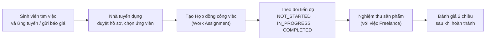
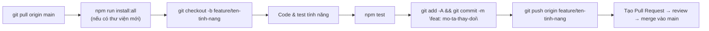

# JOBNEST — Nền tảng việc làm Part-time & Freelance cho Sinh viên

> **Đồ án Chuyên đề Tốt nghiệp 2** — Khoa Công nghệ Thông tin, Trường Đại học Văn Lang (VLU)
> Mã học phần: `242_71ITBS40103_01` · GVHD: ThS. Nguyễn Văn Trung

JobNest là nền tảng kết nối **sinh viên** với các công việc **bán thời gian, thời vụ và dự án freelance**, giúp nhà tuyển dụng đăng tin, duyệt hồ sơ và theo dõi tiến độ công việc minh bạch qua hệ thống hợp đồng số (*Work Assignment*) và đánh giá hai chiều.

File này là **tài liệu hướng dẫn duy nhất bạn cần** để hiểu dự án và tự chạy được nó trên máy mình — kể cả khi bạn **chưa từng cài đặt Node.js hay PostgreSQL bao giờ**. Cứ làm theo đúng thứ tự từng bước, đừng bỏ bước nào.

---

## Mục lục

1. [Dự án này là gì, dùng để làm gì](#1-dự-án-này-là-gì-dùng-để-làm-gì)
2. [Vai trò người dùng trong hệ thống](#2-vai-trò-người-dùng-trong-hệ-thống)
3. [Công nghệ sử dụng](#3-công-nghệ-sử-dụng)
4. [Cấu trúc thư mục dự án](#4-cấu-trúc-thư-mục-dự-án)
5. [Trước khi bắt đầu: chọn 1 trong 2 cách chạy](#5-trước-khi-bắt-đầu-chọn-1-trong-2-cách-chạy)
6. [CÁCH A — Chạy bằng Docker (khuyến nghị, dễ nhất)](#6-cách-a--chạy-bằng-docker-khuyến-nghị-dễ-nhất)
7. [CÁCH B — Chạy thủ công (tự cài Node.js + PostgreSQL)](#7-cách-b--chạy-thủ-công-tự-cài-nodejs--postgresql)
8. [Tài khoản dùng thử (Demo Accounts)](#8-tài-khoản-dùng-thử-demo-accounts)
9. [Bảng lệnh thường dùng (Cheatsheet)](#9-bảng-lệnh-thường-dùng-cheatsheet)
10. [Kiểm tra hệ thống đang chạy tốt hay không](#10-kiểm-tra-hệ-thống-đang-chạy-tốt-hay-không)
11. [Tổng quan API](#11-tổng-quan-api)
12. [Chạy kiểm thử tự động (Testing)](#12-chạy-kiểm-thử-tự-động-testing)
13. [Đóng gói bản production](#13-đóng-gói-bản-production)
14. [Xử lý lỗi thường gặp](#14-xử-lý-lỗi-thường-gặp)
15. [Bảo mật — những điều tuyệt đối không được làm](#15-bảo-mật--những-điều-tuyệt-đối-không-được-làm)
16. [Quy trình làm việc nhóm với Git](#16-quy-trình-làm-việc-nhóm-với-git)
17. [Tài liệu kỹ thuật khác trong dự án](#17-tài-liệu-kỹ-thuật-khác-trong-dự-án)
18. [Giới hạn hiện tại của hệ thống](#18-giới-hạn-hiện-tại-của-hệ-thống)
19. [Thông tin nhóm thực hiện](#19-thông-tin-nhóm-thực-hiện)

---

## 1. Dự án này là gì, dùng để làm gì

JobNest giải quyết 2 bài toán:

- **Sinh viên** cần tìm việc làm thêm uy tín, lịch linh hoạt, biết rõ lương trước khi ứng tuyển, và được bảo vệ quyền lợi khi làm freelance.
- **Nhà tuyển dụng** (doanh nghiệp vừa và nhỏ) cần đăng tin nhanh, lọc ứng viên tốt, và quản lý tiến độ công việc không cần gặp mặt.

**Luồng nghiệp vụ chính:**



**Tính năng chính:**

| Nhóm tính năng | Mô tả |
|---|---|
| Tìm & lọc việc làm | Tìm theo từ khóa, ngành nghề, mức lương, địa điểm (có bản đồ Leaflet) |
| Ứng tuyển Part-time / Báo giá Freelance | Sinh viên nộp CV hoặc gửi đề xuất (proposal) kèm thời gian cam kết |
| Quản lý tuyển dụng | Nhà tuyển dụng xem danh sách ứng viên, duyệt chọn (tạo hợp đồng tự động) |
| Hợp đồng & tiến độ | Theo dõi trạng thái công việc theo quy trình chuẩn (FSM) |
| Nghiệm thu sản phẩm | Sinh viên nộp bài, nhà tuyển dụng duyệt hoặc yêu cầu sửa |
| Đánh giá 2 chiều | Nhà tuyển dụng và sinh viên chấm sao, nhận xét lẫn nhau |
| Thông báo real-time | Báo thay đổi trạng thái đơn, hợp đồng, phản hồi |
| Trang quản trị Admin | Duyệt tin đăng, khoá tài khoản vi phạm, xử lý báo cáo, xem thống kê KPI |

---

## 2. Vai trò người dùng trong hệ thống

| Vai trò | Là ai | Làm được gì |
|---|---|---|
| **STUDENT** (Sinh viên) | Người đi tìm việc | Tạo hồ sơ, ứng tuyển, gửi proposal, cập nhật tiến độ, nộp sản phẩm, đánh giá |
| **EMPLOYER** (Nhà tuyển dụng) | Doanh nghiệp/cá nhân tuyển người | Đăng tin, duyệt ứng viên, tạo hợp đồng, nghiệm thu, đánh giá |
| **ADMIN** (Quản trị viên) | Ban quản trị sàn JobNest | Duyệt/từ chối tin đăng, khoá tài khoản vi phạm, xử lý khiếu nại, xem KPI |

---

## 3. Công nghệ sử dụng

| Thành phần | Công nghệ | Phiên bản |
|---|---|---|
| Backend (API) | Node.js + Express.js | Node `>= 20`, Express `4.21.x` |
| Kết nối CSDL | `pg` (PostgreSQL client), connection pooling | `8.13.x` |
| Xác thực | JWT (`jsonwebtoken`) + mã hoá mật khẩu (`bcryptjs`) | — |
| Kiểm thử Backend | Node.js Test Runner (`node:test`) có sẵn, không cần cài thêm | — |
| Frontend (giao diện) | React + Vite | React `19.x`, Vite `8.x` |
| Giao diện & icon | `lucide-react`, `motion`, `@animate-ui/react` | — |
| Bản đồ | `leaflet` (OpenStreetMap, cần Internet để tải nền bản đồ) | — |
| Cơ sở dữ liệu | PostgreSQL | `>= 14` (khuyên dùng 15–17) |
| Đóng gói | Docker + Docker Compose (tuỳ chọn) | — |

---

## 4. Cấu trúc thư mục dự án

```text
Chuyên Đề 2/
├── 02_database/              # Lược đồ CSDL, migration, dữ liệu mẫu
│   ├── migrations/           # File SQL tạo từng bảng (chạy bằng npm run migrate)
│   ├── seeds/                # File SQL nạp dữ liệu mẫu (npm run seed)
│   └── cd2_marketplace_full_dump.sql   # Bản dump đầy đủ: toàn bộ bảng + dữ liệu mẫu
│
├── 03_backend/                # Mã nguồn máy chủ API (Node.js + Express)
│   ├── src/
│   │   ├── config/            # Kết nối DB, migrate, seed, auto-bootstrap
│   │   ├── middleware/        # Xác thực (auth), xử lý lỗi
│   │   ├── modules/           # Nghiệp vụ: auth, jobs, applications, proposals,
│   │   │                      #   selections, assignments, reviews, reports, notifications
│   │   ├── app.js             # Cấu hình Express app, CORS, route
│   │   └── server.js          # File khởi chạy server (cổng 5000)
│   ├── tests/integration/     # Bộ test tích hợp
│   ├── .env.example           # Mẫu file cấu hình môi trường (copy thành .env)
│   └── package.json
│
├── 04_frontend/                # Mã nguồn giao diện (React + Vite)
│   ├── src/
│   │   ├── components/         # Thành phần UI dùng chung (header, footer, card...)
│   │   ├── pages/               # admin/, employer/, student/, guest/
│   │   ├── services/            # Kết nối API (api.js)
│   │   └── main.jsx
│   ├── .env.example             # Mẫu cấu hình môi trường frontend
│   └── package.json
│
├── docs/                       # Tài liệu kỹ thuật, báo cáo, sơ đồ kiến trúc
├── infrastructure/             # Cấu hình hạ tầng bổ sung (CRM nội bộ, nginx...)
├── connect_db.js / connect_db.bat    # Công cụ tự động kết nối & khởi tạo CSDL
├── setup_new_machine.bat             # Script cài đặt 1-click cho máy Windows mới
├── setup_temp_admin.js               # Công cụ tạo nhanh tài khoản Admin thử nghiệm
├── docker-compose.yml                # Cấu hình chạy toàn bộ hệ thống bằng Docker
├── package.json                      # Script điều phối chung (gọi backend + frontend)
└── README.md                         # Chính là file bạn đang đọc
```

---

## 5. Trước khi bắt đầu: chọn 1 trong 2 cách chạy

Có **2 cách** để chạy được dự án này. Bạn chỉ cần chọn **một** cách, không cần làm cả hai.

| | **CÁCH A — Docker** | **CÁCH B — Thủ công** |
|---|---|---|
| Cần cài gì | Chỉ cần **Docker Desktop** | Node.js + PostgreSQL + Git |
| Độ khó | ⭐ Dễ nhất, gần như tự động | ⭐⭐⭐ Cần làm nhiều bước tay |
| Phù hợp với | Người mới, muốn chạy thử nhanh | Người muốn sửa code, debug sâu |
| Thời gian | ~10 phút | ~20–30 phút |

> 💡 **Nếu bạn không chắc nên chọn cách nào → chọn CÁCH A (Docker).** Nó đơn giản và ít lỗi vặt hơn nhiều.

---

## 6. CÁCH A — Chạy bằng Docker (khuyến nghị, dễ nhất)

Cách này **không cần cài Node.js hay PostgreSQL** lên máy. Mọi thứ (database, backend, frontend) chạy gọn trong Docker.

### Bước 1 — Cài Docker Desktop

1. Tải tại: [https://www.docker.com/products/docker-desktop/](https://www.docker.com/products/docker-desktop/)
2. Cài đặt như một phần mềm bình thường (Next → Next → Finish), sau đó **khởi động lại máy** nếu được yêu cầu.
3. Mở Docker Desktop lên, đợi đến khi biểu tượng cá voi 🐳 chuyển sang màu xanh (nghĩa là đã chạy).
4. Mở **PowerShell** (hoặc Terminal) và kiểm tra:
   ```powershell
   docker version
   docker compose version
   ```
   Nếu cả 2 lệnh đều ra thông tin phiên bản (không báo lỗi) → đã sẵn sàng.

### Bước 2 — Tải mã nguồn dự án

Nếu dùng Git:
```powershell
git clone <đường-dẫn-repository-của-bạn>
cd "Chuyên Đề 2"
```
Nếu không dùng Git: giải nén file `.zip` của dự án ra một thư mục, rồi mở Terminal **ngay tại thư mục đó**.

### Bước 3 — Tạo file cấu hình `.env`

Ở thư mục gốc dự án (cùng cấp với `docker-compose.yml`), chạy:
```powershell
copy .env.docker.example .env
```
*(Trên macOS/Linux dùng `cp .env.docker.example .env`)*

Mở file `.env` vừa tạo bằng Notepad hoặc VS Code, điền **2 giá trị bắt buộc**:

```env
POSTGRES_PASSWORD=đặt-một-mật-khẩu-bất-kỳ-ở-đây
JWT_SECRET=chuỗi-ký-tự-ngẫu-nhiên-ít-nhất-32-ký-tự
```

Muốn tạo nhanh `JWT_SECRET` ngẫu nhiên (nếu máy có Node.js), chạy:
```powershell
node -e "console.log(require('crypto').randomBytes(32).toString('hex'))"
```
Không có Node.js cũng không sao — tự gõ đại một chuỗi dài ≥ 32 ký tự (chữ + số) là được.

> ⚠️ File `.env` đã nằm trong `.gitignore` — **không bao giờ** commit file này lên Git vì nó chứa mật khẩu thật.

### Bước 4 — Khởi động toàn bộ hệ thống

```powershell
docker compose up -d
```

Lần chạy đầu tiên sẽ hơi lâu (vài phút) vì Docker phải tải image và build ứng dụng. Nó sẽ **tự động nạp sẵn dữ liệu mẫu** vào database, bạn không cần làm gì thêm.

Kiểm tra cả 3 dịch vụ đã chạy xong (trạng thái `healthy`):
```powershell
docker compose ps
```

### Bước 5 — Mở ứng dụng

| Thành phần | Địa chỉ |
|---|---|
| **Giao diện web (mở cái này)** | [http://localhost:8080](http://localhost:8080) |
| Kiểm tra sức khoẻ hệ thống | [http://localhost:8080/health](http://localhost:8080/health) |
| API backend (để debug) | [http://localhost:5000/health](http://localhost:5000/health) |

Mở trình duyệt, vào `http://localhost:8080` — nếu thấy giao diện JobNest hiện ra là **thành công**. Đăng nhập thử bằng [tài khoản demo ở mục 8](#8-tài-khoản-dùng-thử-demo-accounts).

### Các lệnh Docker hay dùng sau này

```powershell
docker compose logs -f backend      # Xem log backend (để debug lỗi)
docker compose logs -f frontend     # Xem log frontend
docker compose stop                 # Tạm dừng (giữ nguyên dữ liệu)
docker compose start                # Chạy lại sau khi stop
docker compose down                 # Dừng và xoá container (database vẫn còn)
docker compose down -v              # Xoá SẠCH kể cả database (nạp lại từ đầu)
docker compose up -d --build        # Build lại sau khi có sửa code
```

➡️ Nếu gặp lỗi khi làm theo cách này, xem ngay [mục 14 — Xử lý lỗi thường gặp](#14-xử-lý-lỗi-thường-gặp).

---

## 7. CÁCH B — Chạy thủ công (tự cài Node.js + PostgreSQL)

Dùng cách này nếu bạn cần sửa code, debug sâu, hoặc không muốn dùng Docker. Hướng dẫn dưới đây viết cho người **chưa cài bất kỳ công cụ lập trình nào**.

### Bước 1 — Cài Git

1. Tải tại [git-scm.com/download/win](https://git-scm.com/download/win)
2. Cài đặt theo mặc định (bấm Next liên tục).
3. Kiểm tra: mở PowerShell, gõ `git --version` → phải ra dạng `git version 2.x.x`.

### Bước 2 — Cài Node.js

1. Tải bản **LTS** tại [nodejs.org](https://nodejs.org/)
2. Cài đặt theo mặc định.
3. Mở **cửa sổ PowerShell mới** (bắt buộc phải mở mới để nhận thay đổi), kiểm tra:
   ```powershell
   node -v
   npm -v
   ```
   Kết quả hợp lệ: `node` ≥ `v20.0.0`, `npm` ≥ `9.x`.

### Bước 3 — Cài PostgreSQL

1. Tải tại [postgresql.org/download/windows](https://www.postgresql.org/download/windows/)
2. Khi cài, màn hình sẽ hỏi **mật khẩu** cho tài khoản `postgres` — **đặt một mật khẩu và ghi nhớ thật kỹ**, bạn sẽ cần dùng lại ở Bước 6.
3. Giữ cổng mặc định `5432`, các bước còn lại bấm Next theo mặc định.
4. Kiểm tra PostgreSQL đã chạy: nhấn `Windows + R`, gõ `services.msc`, tìm dòng `postgresql-x64-...`, cột **Status** phải là **Running**.

### Bước 4 — Tải mã nguồn dự án

```powershell
git clone <đường-dẫn-repository-của-bạn>
cd "Chuyên Đề 2"
```

### Bước 5 — Cài các thư viện cần thiết

Từ thư mục gốc dự án, chạy **một lệnh duy nhất** (tự cài cho cả backend lẫn frontend):
```powershell
npm run install:all
```
Đợi cho đến khi chạy xong hẳn (không còn dòng lệnh nào chạy nữa), việc này có thể mất vài phút.

### Bước 6 — Tạo file cấu hình `.env` cho Backend

```powershell
copy 03_backend\.env.example 03_backend\.env
```
*(macOS/Linux: `cp 03_backend/.env.example 03_backend/.env`)*

Mở file `03_backend/.env` bằng Notepad hoặc VS Code, sửa các dòng sau cho đúng với máy bạn:

```env
PORT=5000
NODE_ENV=development

DB_HOST=localhost
DB_PORT=5432
DB_USER=postgres
DB_PASSWORD=mật-khẩu-bạn-đặt-ở-Bước-3
DB_NAME=cd2_marketplace_db

JWT_SECRET=chuỗi-ký-tự-ngẫu-nhiên-ít-nhất-32-ký-tự
JWT_EXPIRES_IN=7d
```

| Biến | Ý nghĩa | Bắt buộc sửa? |
|---|---|---|
| `DB_PASSWORD` | Mật khẩu PostgreSQL bạn đặt lúc cài | **Có** — sai là không kết nối được |
| `JWT_SECRET` | Khoá bí mật để mã hoá phiên đăng nhập | **Có** — phải ≥ 32 ký tự |
| `DB_NAME` | Tên database sẽ tạo ở bước sau | Giữ nguyên `cd2_marketplace_db` |
| Các dòng còn lại | Có giá trị mặc định sẵn | Không cần sửa |

### Bước 7 — Tạo file cấu hình `.env` cho Frontend (tuỳ chọn)

Mặc định frontend tự gọi API ở `http://localhost:5000/api`. Nếu backend và frontend chạy **trên cùng một máy** thì **bỏ qua bước này**. Nếu chạy trên 2 máy khác nhau trong cùng mạng LAN:
```powershell
copy 04_frontend\.env.example 04_frontend\.env
```
Sửa trong file vừa tạo:
```env
VITE_API_URL=http://<IP-máy-chạy-backend>:5000/api
```

### Bước 8 — Tạo database và nạp dữ liệu

**Cách nhanh nhất (khuyến nghị)** — chạy công cụ tự động từ thư mục gốc:
```powershell
npm run connect:db
```
Lệnh này tự dò cổng, kiểm tra kết nối và **tự tạo database** `cd2_marketplace_db` nếu chưa có.

Sau đó nạp cấu trúc bảng + dữ liệu mẫu:
```powershell
npm run migrate
npm run seed
```

> **Cách thay thế (nạp nhanh toàn bộ bằng 1 file, nếu máy có `psql`):**
> ```powershell
> psql -U postgres -d cd2_marketplace_db -f 02_database/cd2_marketplace_full_dump.sql
> ```
> Lệnh này nạp luôn toàn bộ 30 bảng kèm dữ liệu mẫu (kể cả các tài khoản demo ở mục 8) trong một bước.

### Bước 9 — Chạy Backend

Mở **Terminal thứ nhất**, từ thư mục gốc dự án:
```powershell
npm run dev:backend
```
Thành công khi thấy dòng tương tự:
```
✅ [BOOTSTRAP] Kết nối PostgreSQL thành công.
🚀 CD2 Marketplace Backend is running on http://127.0.0.1:5000
```
**Giữ cửa sổ này mở**, không tắt đi.

### Bước 10 — Chạy Frontend

Mở **Terminal thứ hai** (terminal mới, khác với Terminal 1), từ thư mục gốc dự án:
```powershell
npm run dev:frontend
```
Khi thấy dòng báo `Local: http://localhost:5173/` là đã chạy xong.

### Bước 11 — Mở ứng dụng

Mở trình duyệt, truy cập: **[http://localhost:5173](http://localhost:5173)**

Đăng nhập thử bằng [tài khoản demo ở mục 8](#8-tài-khoản-dùng-thử-demo-accounts) để kiểm tra mọi thứ hoạt động.

> 💡 **Mẹo cho Windows:** bạn có thể chạy nhanh các Bước 5–8 cùng lúc bằng cách double-click vào file `setup_new_machine.bat` ở thư mục gốc — nó tự cài thư viện, kết nối CSDL, nạp dữ liệu và tạo sẵn tài khoản Admin.

➡️ Nếu gặp lỗi khi làm theo cách này, xem ngay [mục 14 — Xử lý lỗi thường gặp](#14-xử-lý-lỗi-thường-gặp).

---

## 8. Tài khoản dùng thử (Demo Accounts)

Sau khi đã nạp dữ liệu mẫu (Docker tự nạp sẵn; cách thủ công cần làm Bước 8), dùng các tài khoản sau để đăng nhập thử — **mật khẩu chung cho tất cả là `password123`**:

| Vai trò | Email | Mật khẩu | Dùng để thử gì |
|---|---|---|---|
| Admin | `admin.test@vlu.edu.vn` | `password123` | Toàn quyền quản trị, duyệt tin, xử lý báo cáo, xem KPI |
| Nhà tuyển dụng | `employer.test@gmail.com` | `password123` | Đăng việc, duyệt báo giá, quản lý hợp đồng |
| Sinh viên (IT) | `nguyen.van.chi@vlu.edu.vn` | `password123` | Ứng tuyển, gửi proposal, nộp sản phẩm |
| Sinh viên (QTKD) | `le.quang.tuan@vlu.edu.vn` | `password123` | Ứng tuyển part-time, đánh giá nhà tuyển dụng |

> 🔒 Các tài khoản này **chỉ dùng để demo/kiểm thử**. Nếu triển khai thật (production), phải xoá hoặc đổi mật khẩu toàn bộ tài khoản mẫu.

---

## 9. Bảng lệnh thường dùng (Cheatsheet)

Tất cả chạy từ **thư mục gốc dự án**:

| Lệnh | Tác dụng |
|---|---|
| `npm run install:all` | Cài thư viện cho cả backend và frontend |
| `npm run connect:db` | Tự động kết nối / tạo database |
| `npm run migrate` | Tạo cấu trúc bảng trong database |
| `npm run seed` | Nạp dữ liệu mẫu |
| `npm run dev:backend` | Chạy server API (cổng 5000) |
| `npm run dev:frontend` | Chạy giao diện web (cổng 5173) |
| `npm test` | Chạy toàn bộ test tự động của backend |
| `npm run build:frontend` | Đóng gói frontend cho production |
| `docker compose up -d` | (Docker) Khởi động toàn bộ hệ thống |
| `docker compose down` | (Docker) Dừng hệ thống, giữ dữ liệu |

---

## 10. Kiểm tra hệ thống đang chạy tốt hay không

Truy cập đường dẫn health check:

- Chạy thủ công (Cách B): [http://localhost:5000/health](http://localhost:5000/health)
- Chạy bằng Docker (Cách A): [http://localhost:8080/health](http://localhost:8080/health)

**Kết quả bình thường** (HTTP 200):
```json
{
  "status": "ok",
  "db": "ok",
  "service": "cd2-marketplace-backend",
  "timestamp": "2026-11-06T10:00:00.000Z"
}
```

**Nếu database chưa kết nối được** (HTTP 503):
```json
{
  "status": "degraded",
  "db": "unhealthy: connect ECONNREFUSED 127.0.0.1:5432"
}
```
→ Xem [mục 14](#14-xử-lý-lỗi-thường-gặp) để khắc phục.

---

## 11. Tổng quan API

Backend hỗ trợ cả 2 tiền tố `/api` và `/api/v1` (dùng cái nào cũng được, kết quả giống nhau).

| Nhóm | Endpoint chính | Mô tả |
|---|---|---|
| Hệ thống | `GET /health` | Kiểm tra server và kết nối DB |
| Xác thực | `POST /api/auth/register` | Đăng ký tài khoản (STUDENT hoặc EMPLOYER) |
| Xác thực | `POST /api/auth/login` | Đăng nhập, trả về JWT token |
| Hồ sơ | `GET /api/profile/me` | Lấy thông tin người dùng đang đăng nhập |
| Việc làm | `GET /api/jobs` | Danh sách tin tuyển dụng (có lọc, phân trang) |
| Việc làm | `GET /api/jobs/:id` | Chi tiết một tin tuyển dụng |
| Việc làm | `POST /api/jobs` | Nhà tuyển dụng đăng tin mới |
| Ứng tuyển | `POST /api/applications` | Sinh viên nộp đơn ứng tuyển part-time |
| Tuyển chọn | `POST /api/jobs/:jobId/selections` | Duyệt ứng viên và tự động tạo hợp đồng |
| Báo giá | `POST /api/proposals` | Sinh viên gửi báo giá cho việc freelance |
| Hợp đồng | `GET /api/assignments/my-assignments` | Danh sách hợp đồng của sinh viên |
| Hợp đồng | `PATCH /api/assignments/:id/progress` | Cập nhật tiến độ công việc |
| Đánh giá | `POST /api/reviews` | Đánh giá hai chiều sau khi hoàn thành việc |

---

## 12. Chạy kiểm thử tự động (Testing)

```powershell
npm test
```
hoặc chạy trực tiếp trong thư mục backend:
```powershell
cd 03_backend
npm test
```

Kết quả mong đợi: tất cả test đều **PASS**, bao phủ các nghiệp vụ: xác thực, tin tuyển dụng, ứng tuyển, báo giá, tuyển chọn ứng viên, hợp đồng công việc, đánh giá, và thông báo hệ thống.

---

## 13. Đóng gói bản production

```powershell
npm run build:frontend
```
hoặc:
```powershell
cd 04_frontend
npm run build
```
Kết quả: mã nguồn frontend đã tối ưu sẽ nằm trong thư mục `04_frontend/dist/`.

---

## 14. Xử lý lỗi thường gặp

| Lỗi gặp phải | Nguyên nhân | Cách khắc phục |
|---|---|---|
| `'node' is not recognized` | Chưa cài Node.js hoặc chưa cập nhật PATH | Cài lại Node.js LTS, mở terminal mới |
| `'npm' is not recognized` | npm chưa được nhận trong PATH | Khởi động lại máy, thử lại |
| `connect ECONNREFUSED 127.0.0.1:5432` | PostgreSQL chưa chạy | Mở `services.msc`, bật `postgresql-x64-...` |
| `password authentication failed for user "postgres"` | Sai mật khẩu trong `.env` | Sửa lại `DB_PASSWORD` trong `03_backend/.env` cho đúng |
| `database "cd2_marketplace_db" does not exist` | Chưa tạo database | Chạy `npm run connect:db` |
| `Cannot find module '...'` | Chưa cài thư viện | Chạy `npm run install:all` từ thư mục gốc |
| `Port 5000 is already in use` | Cổng 5000 đang bị chiếm | Tắt tiến trình đang dùng cổng, hoặc đổi `PORT` trong `.env` |
| Frontend không gọi được API / lỗi CORS | Sai `VITE_API_URL` hoặc `CORS_ORIGINS` | Kiểm tra lại 2 giá trị này trong file `.env` tương ứng |
| `relation "..." does not exist` | Database chưa có đủ bảng | Chạy `npm run migrate`, hoặc nạp lại file dump đầy đủ |
| **(Docker)** `required variable POSTGRES_PASSWORD is missing` | Chưa tạo file `.env` ở gốc dự án hoặc để trống | Làm lại Bước 3 ở [mục 6](#6-cách-a--chạy-bằng-docker-khuyến-nghị-dễ-nhất) |
| **(Docker)** container `postgres` không `healthy` | Cổng 5432 trên máy đang bị chiếm | Tắt PostgreSQL cài sẵn trên máy, hoặc xoá dòng `5432:5432` trong `docker-compose.yml` |
| **(Docker)** cổng 8080 đã có app khác dùng | Trùng cổng | Đổi `"8080:80"` thành cổng khác (ví dụ `"3000:80"`) trong `docker-compose.yml` |
| **(Docker)** `relation ... does not exist` | Dữ liệu chưa được nạp (volume cũ, lỗi) | Chạy `docker compose down -v` rồi `docker compose up -d` lại |
| **(Docker)** Docker daemon không chạy | Docker Desktop chưa mở | Mở Docker Desktop, đợi icon cá voi chuyển xanh |

> Không tìm thấy lỗi của bạn trong bảng trên? Mở log chi tiết để xem nguyên nhân chính xác:
> - Chạy thủ công: đọc log ngay trong cửa sổ terminal đang chạy `npm run dev:backend`.
> - Docker: chạy `docker compose logs -f backend` hoặc `docker compose logs -f frontend`.

---

## 15. Bảo mật — những điều tuyệt đối không được làm

1. **Không bao giờ đưa file `.env` lên Git/GitHub.** File này chứa mật khẩu database và khoá JWT. Nó đã được liệt kê trong `.gitignore`, nhưng vẫn hãy tự kiểm tra lại trước khi `git push`.
2. **`JWT_SECRET` phải là chuỗi ngẫu nhiên, dài tối thiểu 32 ký tự** — không dùng các chuỗi mẫu có sẵn trong tài liệu khi triển khai thật.
3. **Mật khẩu người dùng luôn được mã hoá bằng `bcrypt`** trước khi lưu vào database — không bao giờ lưu mật khẩu dạng chữ thường (plain text).
4. **Mọi câu truy vấn SQL đều dùng tham số hoá** (`$1, $2, ...`) để chống SQL Injection — không tự nối chuỗi SQL trực tiếp khi viết thêm code.
5. **Tài khoản demo ở mục 8 chỉ dùng để thử nghiệm** — xoá hoặc đổi mật khẩu trước khi đưa hệ thống ra môi trường thật.

---

## 16. Quy trình làm việc nhóm với Git



Quy tắc ngắn gọn:
- Nhánh ổn định chính là `main`. **Không code trực tiếp trên `main`.**
- Trước khi bắt đầu việc mới: `git checkout main && git pull origin main`.
- Mỗi tính năng làm trên 1 nhánh riêng: `git checkout -b feature/ten-tinh-nang`.
- Commit message rõ ràng, ví dụ: `git commit -m "feat: them bo loc viec lam theo luong"`.

---

## 17. Tài liệu kỹ thuật khác trong dự án

| Tài liệu | Nội dung |
|---|---|
| [`SETUP.md`](./SETUP.md) | Hướng dẫn chạy thủ công chi tiết hơn (không Docker) |
| [`DOCKER.md`](./DOCKER.md) | Hướng dẫn chạy bằng Docker chi tiết hơn |
| [`PRODUCT.md`](./PRODUCT.md) | Đặc tả sản phẩm, persona người dùng, luồng nghiệp vụ |
| [`docs/architecture/README.md`](docs/architecture/README.md) | Sơ đồ kiến trúc hệ thống (Draw.io): Context, Application, Database ERD, Deployment, Auth flow |
| [`02_database/erd/`](02_database/erd) | Sơ đồ quan hệ thực thể cơ sở dữ liệu |
| [`infrastructure/twenty/README.md`](infrastructure/twenty/README.md) | Hệ thống quản trị quan hệ đối tác (Twenty CRM), chạy độc lập tại `http://localhost:3020` |
| [`docs/`](docs) | Các báo cáo kỹ thuật, kiểm định, nhật ký thay đổi chi tiết của dự án |

---

## 18. Giới hạn hiện tại của hệ thống

1. Lệnh `npm run dev` ở thư mục gốc chỉ chạy **frontend**. Cần mở 2 terminal riêng để chạy song song `dev:backend` và `dev:frontend` (xem [Cách B](#7-cách-b--chạy-thủ-công-tự-cài-nodejs--postgresql)).
2. Bản đồ (Leaflet) dùng nền bản đồ miễn phí của OpenStreetMap — **cần có kết nối Internet** để hiển thị bản đồ.
3. Hiện tại CV và ảnh đại diện lưu dưới dạng URL tĩnh/mock — chưa cấu hình lưu trữ đám mây (ví dụ AWS S3) trong bản thử nghiệm cục bộ.

---

## 19. Thông tin nhóm thực hiện

**Sinh viên thực hiện:**
1. Nguyễn Tấn Hoàng Thông — MSSV `2374802010485`
2. Lê Quang Anh Tuấn — MSSV `2374802010538`
3. Nguyễn Văn Chí — MSSV `2374802010056`

**Đơn vị đào tạo:** Khoa Công nghệ Thông tin, Trường Đại học Văn Lang (VLU)
**Giảng viên hướng dẫn:** ThS. Nguyễn Văn Trung
**Năm thực hiện:** 2026

---

> 🆘 **Vẫn bị kẹt chỗ nào đó?** Đọc kỹ lại đúng bước đang làm trong [mục 6](#6-cách-a--chạy-bằng-docker-khuyến-nghị-dễ-nhất) hoặc [mục 7](#7-cách-b--chạy-thủ-công-tự-cài-nodejs--postgresql), đối chiếu thông báo lỗi với [mục 14](#14-xử-lý-lỗi-thường-gặp). Phần lớn lỗi khi mới chạy dự án đều nằm ở: **sai mật khẩu database**, **PostgreSQL chưa bật**, hoặc **quên tạo file `.env`**.
