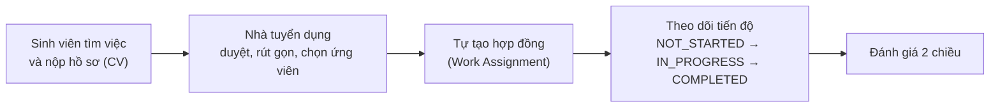

# JOBNEST — Nền tảng việc làm Part-time & Full-time cho Sinh viên

> **Đồ án Chuyên đề Tốt nghiệp 2** — Khoa Công nghệ Thông tin, Trường Đại học Văn Lang (VLU)
> Mã học phần: `242_71ITBS40103_01` · GVHD: ThS. Nguyễn Văn Trung

JobNest kết nối **sinh viên** với việc làm **bán thời gian (Part-time)** và **toàn thời gian (Full-time)**. Nhà tuyển dụng đăng tin, duyệt hồ sơ, chọn ứng viên và theo dõi công việc qua hợp đồng số (*Work Assignment*); hai bên đánh giá lẫn nhau sau khi hoàn thành.

- Bản chạy thật: **https://jobnest-beta.vercel.app**
- File này là **hướng dẫn duy nhất** để cài và chạy dự án trên máy của bạn. Làm đúng thứ tự từng bước.

---

## Mục lục

1. [Tính năng & vai trò](#1-tính-năng--vai-trò)
2. [Công nghệ](#2-công-nghệ)
3. [Cấu trúc thư mục](#3-cấu-trúc-thư-mục)
4. [Chọn cách chạy](#4-chọn-cách-chạy)
5. [CÁCH A — Docker (khuyến nghị)](#5-cách-a--docker-khuyến-nghị)
6. [CÁCH B — Chạy thủ công](#6-cách-b--chạy-thủ-công)
7. [Tài khoản demo](#7-tài-khoản-demo)
8. [Bảng lệnh thường dùng](#8-bảng-lệnh-thường-dùng)
9. [Kiểm tra hệ thống](#9-kiểm-tra-hệ-thống)
10. [Tổng quan API](#10-tổng-quan-api)
11. [Kiểm thử tự động](#11-kiểm-thử-tự-động)
12. [Build & triển khai (Vercel)](#12-build--triển-khai-vercel)
13. [Xử lý lỗi thường gặp](#13-xử-lý-lỗi-thường-gặp)
14. [Bảo mật](#14-bảo-mật)
15. [Làm việc nhóm với Git](#15-làm-việc-nhóm-với-git)
16. [Tài liệu khác](#16-tài-liệu-khác)
17. [Giới hạn hiện tại](#17-giới-hạn-hiện-tại)
18. [Nhóm thực hiện](#18-nhóm-thực-hiện)

---

## 1. Tính năng & vai trò



| Vai trò | Làm được gì |
|---|---|
| **STUDENT** — Sinh viên | Tạo hồ sơ + CV, tìm & lưu việc, ứng tuyển / rút đơn, theo dõi hợp đồng, cập nhật tiến độ, đánh giá |
| **EMPLOYER** — Nhà tuyển dụng | Hồ sơ doanh nghiệp + giấy tờ xác minh, đăng tin, duyệt hồ sơ, chọn ứng viên, quản lý hợp đồng, xuất báo cáo Excel/PDF |
| **ADMIN** — Quản trị | Duyệt tin, xác minh doanh nghiệp, xử lý báo cáo/khiếu nại, khóa tài khoản vi phạm, danh mục, nhật ký, KPI |

Tính năng khác: lọc việc theo ngành/lương/địa điểm/lịch rảnh, bản đồ Leaflet, thông báo, đánh giá công ty & tin tuyển dụng, xuất báo cáo Excel/PDF.

---

## 2. Công nghệ

| Thành phần | Công nghệ |
|---|---|
| Backend | Node.js ≥ 20, Express 4, `pg`, JWT (`jsonwebtoken`), `bcryptjs`, `nodemailer` |
| Frontend | React 19 + Vite 8, `lucide-react`, `motion`, `@animate-ui/react`, `leaflet`, `exceljs` |
| Cơ sở dữ liệu | PostgreSQL ≥ 15 (Docker dùng 17) — production dùng Neon |
| Kiểm thử | `node:test` (backend 158 test, frontend 14 test), `oxlint` |
| Triển khai | Docker Compose (máy cá nhân) · Vercel (production) |

---

## 3. Cấu trúc thư mục

```text
Chuyên Đề 2/
├── 02_database/
│   ├── jobnest_schema.sql        # Schema đầy đủ (đã gồm mọi migration) — dùng khi cài mới
│   ├── JobNest_Data_v3.xlsx      # Bộ dữ liệu demo (mỗi sheet = 1 bảng)
│   ├── data_v3_files/            # Ảnh, CV PDF, giấy tờ pháp lý của dữ liệu demo
│   ├── migrations/               # Lịch sử migration SQL
│   └── erd/                      # Sơ đồ ERD
├── 03_backend/                   # API Node.js + Express
│   ├── src/
│   │   ├── config/               # Kết nối DB, kiểm tra khởi động
│   │   ├── middleware/           # Xác thực, phân quyền, xử lý lỗi
│   │   ├── modules/              # auth, jobs, applications, selections, assignments,
│   │   │                         #   reviews, reports, notifications, files, webhooks
│   │   ├── app.js / server.js    # Express app / khởi chạy cổng 5000
│   ├── tests/                    # Test tích hợp, unit, e2e
│   └── .env.example
├── 04_frontend/                  # Giao diện React + Vite
│   ├── src/ (pages/, components/, services/, utils/)
│   ├── nginx.conf / Dockerfile   # Dùng khi chạy bằng Docker
│   └── .env.example
├── api/index.js                  # Hàm serverless Vercel (gọi 03_backend/src/app)
├── scripts/
│   ├── data_v3/                  # Sinh & nạp dữ liệu demo
│   └── prepare_vercel_dist.js    # Bước build cho Vercel
├── 05_wireframes/                # Wireframe draw.io
├── docs/                         # Tài liệu kỹ thuật, kiến trúc, báo cáo
├── docker-compose.yml            # postgres + backend + frontend (+ seed)
├── .env.docker.example           # Mẫu .env cho Docker
├── vercel.json                   # Cấu hình Vercel
└── package.json                  # Lệnh điều phối chung
```

---

## 4. Chọn cách chạy

| | **CÁCH A — Docker** | **CÁCH B — Thủ công** |
|---|---|---|
| Cần cài | Docker Desktop (+ Git) | Git, Node.js ≥ 20, PostgreSQL ≥ 15, Python ≥ 3.10 |
| Độ khó | Dễ, ít lỗi | Nhiều bước hơn |
| Phù hợp | Chạy thử, demo | Sửa code, debug |
| Địa chỉ web | http://localhost:8080 | http://localhost:5173 |

> Không chắc chọn cách nào → chọn **CÁCH A**.

---

## 5. CÁCH A — Docker (khuyến nghị)

### Bước 1 — Cài Docker Desktop

Tải tại https://www.docker.com/products/docker-desktop/, cài đặt, mở Docker Desktop và đợi trạng thái **Engine running**. Kiểm tra trong PowerShell:

```powershell
docker version
docker compose version
```

### Bước 2 — Tải mã nguồn

```powershell
git clone https://github.com/chinguyen-mr/student-parttime-marketplace.git
cd student-parttime-marketplace
```

### Bước 3 — Tạo file `.env` ở thư mục gốc

```powershell
copy .env.docker.example .env
```

*(macOS/Linux: `cp .env.docker.example .env`)*

Mở `.env`, điền 2 giá trị bắt buộc:

```env
POSTGRES_PASSWORD=MatKhauDB2026
JWT_SECRET=chuoi-ngau-nhien-dai-it-nhat-32-ky-tu-abcdef123456
```

- Mật khẩu nên chỉ gồm **chữ và số**.
- Tạo nhanh `JWT_SECRET`: `node -e "console.log(require('crypto').randomBytes(32).toString('hex'))"`

### Bước 4 — Khởi động hệ thống

```powershell
docker compose up -d --build
```

Lần đầu mất vài phút (tải image, build). Database được **tự tạo đủ bảng** ở lần chạy đầu. Kiểm tra cả 3 container ở trạng thái `healthy`:

```powershell
docker compose ps
```

### Bước 5 — Nạp dữ liệu demo

```powershell
docker compose --profile seed run --rm seed
```

Kết thúc bằng dòng `🎉 Hoàn tất: 14670 dòng.` là thành công. (Lệnh này **xóa dữ liệu cũ** rồi nạp lại — chạy lại bất cứ lúc nào muốn đưa dữ liệu về trạng thái ban đầu.)

### Bước 6 — Mở ứng dụng

| | Địa chỉ |
|---|---|
| **Giao diện web** | http://localhost:8080 |
| Health check | http://localhost:8080/health |
| API trực tiếp | http://localhost:5000/health |

Đăng nhập bằng [tài khoản demo](#7-tài-khoản-demo).

### Lệnh Docker hay dùng

```powershell
docker compose logs -f backend               # Xem log backend
docker compose stop / docker compose start   # Tạm dừng / chạy lại (giữ dữ liệu)
docker compose up -d --build                 # Build lại sau khi sửa code
docker compose down                          # Xóa container (giữ dữ liệu)
docker compose down -v                       # Xóa SẠCH cả database (lần sau tạo lại từ đầu)
```

---

## 6. CÁCH B — Chạy thủ công

### Bước 1 — Cài công cụ

| Công cụ | Tải tại | Kiểm tra |
|---|---|---|
| Git | https://git-scm.com/downloads | `git --version` |
| Node.js **LTS ≥ 20** | https://nodejs.org | `node -v` |
| PostgreSQL **≥ 15** | https://www.postgresql.org/download/ | `services.msc` → `postgresql-x64-…` đang **Running** |
| Python **≥ 3.10** (để nạp dữ liệu demo) | https://www.python.org/downloads/ (tick *Add python.exe to PATH*) | `python --version` |

Khi cài PostgreSQL, **ghi nhớ mật khẩu** của user `postgres`. Mở cửa sổ PowerShell **mới** sau khi cài để nhận PATH.

### Bước 2 — Tải mã nguồn & cài thư viện

```powershell
git clone https://github.com/chinguyen-mr/student-parttime-marketplace.git
cd student-parttime-marketplace
npm run install:all
pip install psycopg2-binary openpyxl
```

### Bước 3 — Cấu hình backend

```powershell
copy 03_backend\.env.example 03_backend\.env
```

Sửa trong `03_backend/.env`:

```env
DB_HOST=localhost
DB_PORT=5432
DB_USER=postgres
DB_PASSWORD=mat-khau-postgres-cua-ban
DB_NAME=cd2_marketplace_db
JWT_SECRET=chuoi-ngau-nhien-dai-it-nhat-32-ky-tu
```

Frontend **không cần** `.env` khi chạy cùng máy (Vite tự chuyển `/api` sang `localhost:5000`).

### Bước 4 — Tạo database và bảng

`psql` nằm trong thư mục cài PostgreSQL, ví dụ `C:\Program Files\PostgreSQL\17\bin`. Thêm thư mục đó vào PATH, hoặc gõ đường dẫn đầy đủ:

```powershell
$env:Path += ";C:\Program Files\PostgreSQL\17\bin"
createdb -U postgres cd2_marketplace_db
psql -U postgres -d cd2_marketplace_db -v ON_ERROR_STOP=1 -f 02_database/jobnest_schema.sql
```

*(Không dùng dòng lệnh: mở **pgAdmin** → tạo database `cd2_marketplace_db` → Query Tool → mở file `02_database/jobnest_schema.sql` → Execute.)*

Kiểm tra kết nối từ backend:

```powershell
npm run connect:db
```

### Bước 5 — Nạp dữ liệu demo

```powershell
python scripts/data_v3/import_data_v3.py --yes
```

Script đọc kết nối từ `03_backend/.env`. Kết thúc bằng `🎉 Hoàn tất: 14670 dòng.` là thành công.

### Bước 6 — Chạy backend và frontend (2 cửa sổ terminal)

```powershell
# Terminal 1
npm run dev:backend      # → 🚀 ... running on http://127.0.0.1:5000

# Terminal 2
npm run dev:frontend     # → Local: http://localhost:5173/
```

Mở **http://localhost:5173** và đăng nhập bằng [tài khoản demo](#7-tài-khoản-demo).

> Windows: `setup_new_machine.bat` chạy giúp `npm run install:all` + kiểm tra kết nối DB.

---

## 7. Tài khoản demo

Mật khẩu chung: **`Jobnest@2026`**

| Vai trò | Email |
|---|---|
| Admin | `admin.test@vlu.edu.vn` |
| Nhà tuyển dụng | `employer.test@vlu.edu.vn` |
| Sinh viên | `student.test@vlu.edu.vn` |

Bộ dữ liệu demo còn nhiều tài khoản sinh viên/doanh nghiệp khác (cùng mật khẩu) — xem sheet `users` trong `02_database/JobNest_Data_v3.xlsx`.

> Chỉ dùng để demo. Khi triển khai thật phải đổi mật khẩu hoặc xóa các tài khoản này.

---

## 8. Bảng lệnh thường dùng

Chạy từ thư mục gốc:

| Lệnh | Tác dụng |
|---|---|
| `npm run install:all` | Cài thư viện backend + frontend |
| `npm run connect:db` | Kiểm tra kết nối PostgreSQL theo `03_backend/.env` |
| `npm run dev:backend` | Chạy API (cổng 5000) |
| `npm run dev:frontend` | Chạy giao diện (cổng 5173) |
| `npm test` | Test backend (cần DB, xem [mục 11](#11-kiểm-thử-tự-động)) |
| `npm --prefix 04_frontend test` | Test frontend |
| `npm --prefix 04_frontend run lint` | Kiểm tra code frontend (oxlint) |
| `npm run build:frontend` | Build frontend → `04_frontend/dist/` |
| `python scripts/data_v3/import_data_v3.py --yes` | Nạp lại dữ liệu demo (xóa dữ liệu cũ) |
| `docker compose up -d --build` | (Docker) Chạy toàn bộ hệ thống |
| `docker compose --profile seed run --rm seed` | (Docker) Nạp lại dữ liệu demo |

---

## 9. Kiểm tra hệ thống

Mở http://localhost:5000/health (Docker: http://localhost:8080/health). Bình thường:

```json
{ "status": "ok", "db": "ok", "service": "cd2-marketplace-backend" }
```

Nếu `"status": "degraded"` → backend chạy nhưng không kết nối được DB, xem [mục 13](#13-xử-lý-lỗi-thường-gặp).

---

## 10. Tổng quan API

Mọi route có 2 tiền tố tương đương `/api` và `/api/v1`. Chi tiết: [`docs/api-docs.md`](docs/api-docs.md), bộ Postman trong `postman/`.

| Nhóm | Endpoint chính |
|---|---|
| Hệ thống | `GET /health` |
| Xác thực | `POST /api/auth/register`, `POST /api/auth/login`, quên/đặt lại mật khẩu |
| Hồ sơ | `GET/PUT /api/profile/me` |
| Việc làm | `GET /api/jobs`, `GET /api/jobs/:id`, `POST /api/jobs`, `GET /api/jobs/my-jobs` |
| Ứng tuyển | `POST /api/applications`, `GET /api/applications/my-applications`, `GET /api/applications/job/:jobId`, `PATCH /api/applications/:id/status` |
| Chọn ứng viên | `POST /api/jobs/:jobId/selections` — body `{ "applicationIds": [..] }`, tự tạo hợp đồng |
| Hợp đồng | `GET /api/assignments/my-assignments`, `GET /api/assignments/employer-assignments`, cập nhật tiến độ |
| Đánh giá | `POST /api/reviews` |
| Quản trị | `/api/admin/...` (duyệt tin, người dùng, báo cáo, nhật ký) |

---

## 11. Kiểm thử tự động

**Frontend** (không cần DB):

```powershell
npm --prefix 04_frontend test
```

**Backend** — một phần test dùng PostgreSQL thật (đọc `03_backend/.env`), tự dọn dữ liệu test sau khi chạy:

```powershell
npm test
```

Kết quả mong đợi: `pass 158, fail 0`. Nếu thấy nhiều test `cancelled` kèm lỗi `password authentication failed` / `ECONNREFUSED` → `03_backend/.env` chưa trỏ đúng DB đang chạy (khi dùng Docker: `DB_HOST=localhost`, `DB_PASSWORD` = `POSTGRES_PASSWORD` trong `.env` gốc).

---

## 12. Build & triển khai (Vercel)

```powershell
npm run build:frontend          # chỉ build giao diện
npm run build                   # build đầy đủ như Vercel (frontend + dist cho serverless)
```

Production chạy trên Vercel (project `jobnest`, deploy tự động từ nhánh `main`):

- Frontend tĩnh + API serverless `api/index.js` (dùng lại `03_backend/src/app.js`).
- Biến môi trường trên Vercel: `DATABASE_URL` (Neon PostgreSQL), `JWT_SECRET`, và các biến SMTP nếu gửi email.
- Nạp dữ liệu demo lên DB production: `python scripts/data_v3/import_data_v3.py --db-url "<DATABASE_URL>" --yes`.

---

## 13. Xử lý lỗi thường gặp

| Lỗi | Nguyên nhân | Cách sửa |
|---|---|---|
| `'node'/'npm'/'python' is not recognized` | Chưa cài hoặc chưa có trong PATH | Cài lại, mở terminal mới |
| `ECONNREFUSED 127.0.0.1:5432` | PostgreSQL chưa chạy | `services.msc` → Start `postgresql-x64-…` |
| `password authentication failed` | Sai `DB_PASSWORD` | Sửa `03_backend/.env` |
| `database "cd2_marketplace_db" does not exist` | Chưa tạo DB | Làm lại [Bước 4 Cách B](#bước-4--tạo-database-và-bảng) |
| `relation "..." does not exist` | Chưa nạp schema | Chạy lại lệnh `psql ... -f 02_database/jobnest_schema.sql` trên DB trống |
| `JWT_SECRET phải có ít nhất 32 ký tự` | Thiếu/ngắn | Đặt chuỗi ≥ 32 ký tự |
| `Port 5000/5173 is already in use` | Cổng bận | Tắt chương trình đang dùng cổng (hoặc container Docker cũ) |
| `ModuleNotFoundError: psycopg2` / `openpyxl` | Thiếu thư viện Python | `pip install psycopg2-binary openpyxl` |
| Đăng nhập demo báo sai mật khẩu | Chưa nạp dữ liệu demo | Docker: Bước 5 · Thủ công: Bước 5 |
| **(Docker)** `POSTGRES_PASSWORD chưa được đặt` | Chưa tạo/điền `.env` gốc | Làm lại Bước 3 Cách A |
| **(Docker)** port `5432` already allocated | Máy đã có PostgreSQL cài sẵn dùng 5432 | Tắt PostgreSQL trên máy, **hoặc** xóa 2 dòng `ports: - "5432:5432"` của service `postgres` |
| **(Docker)** port `8080`/`5000` already allocated | Trùng cổng | Đổi `"8080:80"` / `"5000:5000"` trong `docker-compose.yml` |
| **(Docker)** đổi `POSTGRES_PASSWORD` rồi backend không vào được DB | DB đã tạo với mật khẩu cũ | Dùng lại mật khẩu cũ, hoặc `docker compose down -v` rồi làm lại Bước 4–5 |

Xem log chi tiết: terminal đang chạy `npm run dev:backend`, hoặc `docker compose logs -f backend`.

---

## 14. Bảo mật

1. **Không commit file `.env`** (đã có trong `.gitignore`) — chứa mật khẩu DB và `JWT_SECRET`.
2. `JWT_SECRET` ngẫu nhiên, ≥ 32 ký tự; không dùng chuỗi mẫu khi triển khai thật.
3. Mật khẩu người dùng băm bằng `bcrypt`; mọi truy vấn SQL dùng tham số hóa (`$1, $2…`).
4. CV và giấy tờ pháp lý chỉ tải được qua link có khóa ngẫu nhiên hoặc bởi chính chủ/admin.
5. Đổi mật khẩu/xóa tài khoản demo trước khi đưa lên môi trường thật.

---

## 15. Làm việc nhóm với Git

- Nhánh ổn định: `main` (Vercel deploy từ nhánh này). Không code trực tiếp trên `main`.
- Bắt đầu việc mới: `git checkout main && git pull` → `git checkout -b feature/ten-tinh-nang`.
- Trước khi push: `npm --prefix 04_frontend run build`, `npm --prefix 04_frontend test`, `npm test`.
- Commit rõ ràng, ví dụ `feat: them bo loc viec lam theo luong`, rồi tạo Pull Request vào `main`.

---

## 16. Tài liệu khác

| Tài liệu | Nội dung |
|---|---|
| [`DOCKER.md`](DOCKER.md) | Chi tiết cấu hình Docker |
| [`SETUP.md`](SETUP.md) | Chi tiết cài đặt thủ công |
| [`PRODUCT.md`](PRODUCT.md) · [`DESIGN.md`](DESIGN.md) | Đặc tả sản phẩm · hệ thống thiết kế |
| [`docs/architecture/`](docs/architecture) | Sơ đồ kiến trúc (draw.io) |
| [`docs/api-docs.md`](docs/api-docs.md) | Tài liệu API |
| [`scripts/data_v3/README.md`](scripts/data_v3/README.md) | Cách sinh lại bộ dữ liệu demo |
| [`05_wireframes/`](05_wireframes) | Wireframe giao diện (mở bằng draw.io) |
| [`02_database/erd/`](02_database/erd) | Sơ đồ ERD |

---

## 17. Giới hạn hiện tại

1. `npm run dev` ở thư mục gốc chỉ chạy frontend — cần 2 terminal cho backend và frontend (Cách B).
2. Bản đồ Leaflet và ảnh minh họa cần Internet.
3. File tải lên (CV, ảnh, giấy tờ) lưu trong PostgreSQL (bảng `file_uploads`), chưa dùng lưu trữ đám mây.
4. Gửi email cần cấu hình SMTP; không cấu hình thì chức năng quên mật khẩu chỉ ghi log.

---

## 18. Nhóm thực hiện

1. Nguyễn Tấn Hoàng Thông — MSSV `2374802010485`
2. Lê Quang Anh Tuấn — MSSV `2374802010538`
3. Nguyễn Văn Chí — MSSV `2374802010056`

Khoa Công nghệ Thông tin, Trường Đại học Văn Lang · GVHD: ThS. Nguyễn Văn Trung · 2026
