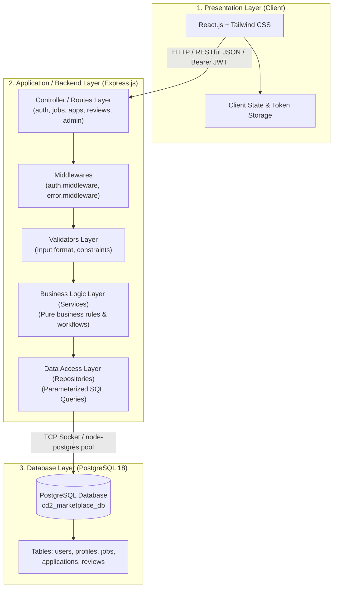
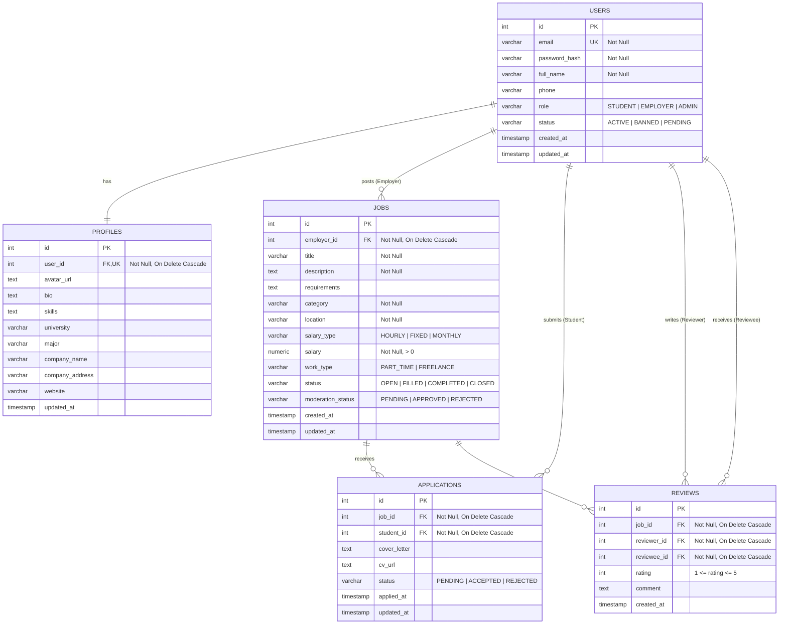
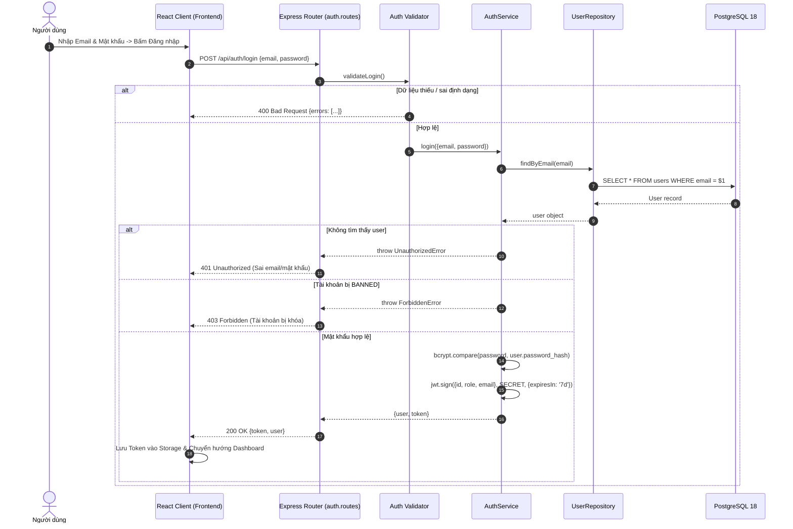
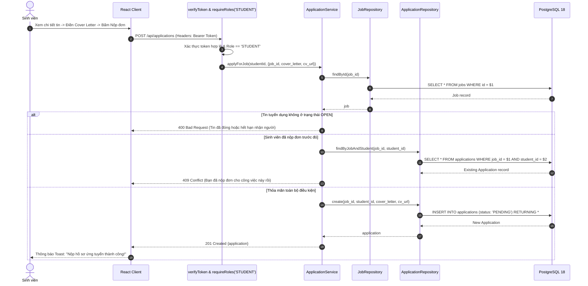

# BÁO CÁO THIẾT KẾ KIẾN TRÚC TỔNG THỂ, CƠ SỞ DỮ LIỆU ERD VÀ THIẾT KẾ CHI TIẾT (BUỔI 4 & BUỔI 5)
**Mốc đánh giá giữa kỳ — Lần 1 (Rubric 2: 30%)**

**Đề tài:** Nền tảng quản lý freelance / marketplace việc làm part-time cho sinh viên  
**Học phần:** Chuyên đề Tốt nghiệp 2 (Khoa CNTT — Trường Đại học Văn Lang)  
**Giảng viên hướng dẫn:** ThS. Nguyễn Văn Trung  
**Nhóm sinh viên thực hiện:**
- Nguyễn Văn Chí (MSSV: 2374802010056) — Nhóm trưởng
- Nguyễn Tấn Hoàng Thông (MSSV: 2374802010485)
- Lê Quang Anh Tuấn (MSSV: 2374802010538)

---

## 1. Mục tiêu và Căn cứ Thiết kế

Tài liệu này tổng hợp sản phẩm bàn giao kỹ thuật của **Buổi 4** (Thiết kế kiến trúc tổng thể) và **Buổi 5** (Thiết kế chi tiết CSDL/API — Mốc đánh giá giữa kỳ 1), tuân thủ:
1. Đề cương bài giảng: `Buoi04_ChuyenDeTotNghiep2.pdf` và `Buoi05_ChuyenDeTotNghiep2.pdf`.
2. Danh mục Use Cases và Quy tắc nghiệp vụ trong `Dac_ta.docx` (UC-01 $\rightarrow$ UC-10).
3. Bảng công nghệ chính thức: `CongNgheSD.xlsx`.

---

## 2. Thiết kế Kiến trúc Tổng thể Hệ thống (Buổi 4)

### 2.1. Sơ đồ Kiến trúc Phân tầng (3-Tier Layered Architecture)
Hệ thống tuân thủ nghiêm ngặt nguyên tắc phân tách trách nhiệm (Separation of Concerns). Các tầng chỉ giao tiếp với tầng kế cận, đảm bảo tầng Business Logic hoàn toàn độc lập với giao thức truyền thông HTTP và cơ sở dữ liệu:



### 2.2. Bảng Lựa chọn Công nghệ & Giải trình Lý do

| Thành phần | Công nghệ lựa chọn | Phiên bản | Lý do kỹ thuật & Tính khả thi trong 10 buổi |
|---|---|---|---|
| **Frontend** | React.js + Tailwind CSS + Vite | React 19, Vite 8 | - Khởi tạo component nhanh, tái sử dụng cao cho 3 phân hệ (Sinh viên, NTD, Admin).<br>- Tailwind CSS giúp xây dựng giao diện responsive nhanh chóng, nhất quán.<br>- Vite tối ưu hóa thời gian build và hot reload cực nhanh. |
| **Backend** | Node.js + Express.js | Node 24, Express 4.21 | - Đồng nhất ngôn ngữ JavaScript từ Frontend đến Backend, giảm chi phí chuyển đổi ngữ cảnh cho nhóm.<br>- Express.js nhỏ gọn, hỗ trợ định tuyến RESTful API linh hoạt, phù hợp kiến trúc 3 tầng sạch. |
| **Database** | PostgreSQL | PostgreSQL 18 Local | - Hỗ trợ chuẩn quan hệ chặt chẽ (ACID), khóa ngoại cascade và kiểm tra ràng buộc (Check Constraints).<br>- Phù hợp lưu trữ dữ liệu liên kết: Người dùng $\rightarrow$ Tin tuyển dụng $\rightarrow$ Đơn ứng tuyển $\rightarrow$ Đánh giá. |
| **Xác thực** | JWT + bcryptjs | jsonwebtoken 9.x, bcryptjs 3.x | - Xác thực phi trạng thái (Stateless Authentication) qua Authorization Bearer Token.<br>- Mã hóa mật khẩu một chiều bằng thuật toán Salted Hash (10 rounds). |
| **Kiểm thử** | Native `node:test` | Node.js Built-in | - Chạy kiểm thử tự động tức thì mà không cần cài thêm các framework nặng nề (Jest/Mocha), đạt độ phủ 100% cho tầng Service. |

---

## 3. Thiết kế Cơ sở Dữ liệu Chi tiết — ERD (Buổi 4 & Buổi 5)

### 3.1. Sơ đồ Thực thể - Liên kết (Entity-Relationship Diagram)



### 3.2. Bảng Đặc tả Chi tiết từng Thực thể & Thuộc tính (Data Dictionary)

#### Bảng 1: `users` (Tài khoản người dùng)
| Tên cột | Kiểu dữ liệu | Khóa | Ràng buộc / Mặc định | Ý nghĩa nghiệp vụ |
|---|---|---|---|---|
| `id` | `SERIAL` | **PK** | NOT NULL | Định danh duy nhất người dùng |
| `email` | `VARCHAR(255)` | **UK** | NOT NULL, UNIQUE | Email đăng nhập hệ thống (chống trùng) |
| `password_hash` | `VARCHAR(255)` | | NOT NULL | Chuỗi băm mật khẩu bằng Bcrypt |
| `full_name` | `VARCHAR(255)` | | NOT NULL | Họ và tên hiển thị |
| `phone` | `VARCHAR(50)` | | NULL | Số điện thoại liên hệ |
| `role` | `VARCHAR(20)` | | CHECK (`role IN ('STUDENT', 'EMPLOYER', 'ADMIN')`) | Vai trò trong hệ thống (FR-01) |
| `status` | `VARCHAR(20)` | | DEFAULT `'ACTIVE'`, CHECK (`IN ('ACTIVE', 'BANNED', 'PENDING')`) | Trạng thái tài khoản |
| `created_at` | `TIMESTAMP WITH TZ` | | DEFAULT `CURRENT_TIMESTAMP` | Thời điểm đăng ký |
| `updated_at` | `TIMESTAMP WITH TZ` | | DEFAULT `CURRENT_TIMESTAMP` | Thời điểm cập nhật cuối |

#### Bảng 2: `profiles` (Hồ sơ người dùng chi tiết)
| Tên cột | Kiểu dữ liệu | Khóa | Ràng buộc / Mặc định | Ý nghĩa nghiệp vụ |
|---|---|---|---|---|
| `id` | `SERIAL` | **PK** | NOT NULL | Khóa chính bảng hồ sơ |
| `user_id` | `INT` | **FK, UK** | NOT NULL, UNIQUE, REFERENCES `users(id)` ON DELETE CASCADE | Khóa ngoại 1-1 với bảng `users` |
| `avatar_url` | `TEXT` | | NULL | Đường dẫn ảnh đại diện |
| `bio` | `TEXT` | | NULL | Giới thiệu bản thân / Tuyên ngôn công ty |
| `skills` | `TEXT` | | NULL | Danh sách kỹ năng chuyên môn |
| `university` | `VARCHAR(255)` | | NULL | Trường Đại học (dành cho Sinh viên) |
| `major` | `VARCHAR(255)` | | NULL | Chuyên ngành học (dành cho Sinh viên) |
| `company_name` | `VARCHAR(255)` | | NULL | Tên công ty / Cửa hàng (dành cho NTD) |
| `company_address`| `VARCHAR(255)` | | NULL | Địa chỉ trụ sở (dành cho NTD) |
| `website` | `VARCHAR(255)` | | NULL | Website đại diện doanh nghiệp |
| `updated_at` | `TIMESTAMP WITH TZ` | | DEFAULT `CURRENT_TIMESTAMP` | Thời điểm cập nhật hồ sơ |

#### Bảng 3: `jobs` (Tin tuyển dụng part-time / freelance)
| Tên cột | Kiểu dữ liệu | Khóa | Ràng buộc / Mặc định | Ý nghĩa nghiệp vụ |
|---|---|---|---|---|
| `id` | `SERIAL` | **PK** | NOT NULL | Mã tin tuyển dụng |
| `employer_id` | `INT` | **FK** | NOT NULL, REFERENCES `users(id)` ON DELETE CASCADE | Nhà tuyển dụng đăng tin |
| `title` | `VARCHAR(255)` | | NOT NULL | Tiêu đề công việc (FR-02) |
| `description` | `TEXT` | | NOT NULL | Mô tả công việc chi tiết |
| `requirements` | `TEXT` | | NULL | Yêu cầu kỹ năng đối với sinh viên |
| `category` | `VARCHAR(100)` | | NOT NULL | Ngành nghề (CNTT, Thiết kế, F&B, Gia sư) |
| `location` | `VARCHAR(255)` | | NOT NULL | Khu vực làm việc (Quận 1, Bình Thạnh, Remote) |
| `salary_type` | `VARCHAR(50)` | | DEFAULT `'HOURLY'`, CHECK (`IN ('HOURLY', 'FIXED', 'MONTHLY')`) | Hình thức tính lương |
| `salary` | `NUMERIC(12, 2)`| | NOT NULL, CHECK (`salary > 0`) | Mức lương chi trả (VNĐ) |
| `work_type` | `VARCHAR(50)` | | DEFAULT `'PART_TIME'`, CHECK (`IN ('PART_TIME', 'FREELANCE')`) | Hình thức làm việc |
| `status` | `VARCHAR(50)` | | DEFAULT `'OPEN'`, CHECK (`IN ('OPEN', 'FILLED', 'COMPLETED', 'CLOSED')`) | Trạng thái tin (FR-06) |
| `moderation_status`| `VARCHAR(50)`| | DEFAULT `'APPROVED'`, CHECK (`IN ('PENDING', 'APPROVED', 'REJECTED')`) | Kiểm duyệt của Admin |
| `created_at` | `TIMESTAMP WITH TZ` | | DEFAULT `CURRENT_TIMESTAMP` | Thời điểm đăng tin |
| `updated_at` | `TIMESTAMP WITH TZ` | | DEFAULT `CURRENT_TIMESTAMP` | Thời điểm cập nhật |

#### Bảng 4: `applications` (Đơn ứng tuyển của sinh viên)
| Tên cột | Kiểu dữ liệu | Khóa | Ràng buộc / Mặc định | Ý nghĩa nghiệp vụ |
|---|---|---|---|---|
| `id` | `SERIAL` | **PK** | NOT NULL | Mã đơn ứng tuyển |
| `job_id` | `INT` | **FK** | NOT NULL, REFERENCES `jobs(id)` ON DELETE CASCADE | Công việc ứng tuyển |
| `student_id` | `INT` | **FK** | NOT NULL, REFERENCES `users(id)` ON DELETE CASCADE | Sinh viên nộp hồ sơ |
| `cover_letter` | `TEXT` | | NULL | Thư giới thiệu bản thân |
| `cv_url` | `TEXT` | | NULL | Link hồ sơ năng lực / file CV |
| `status` | `VARCHAR(50)` | | DEFAULT `'PENDING'`, CHECK (`IN ('PENDING', 'ACCEPTED', 'REJECTED')`) | Trạng thái đơn xét duyệt (FR-05) |
| `applied_at` | `TIMESTAMP WITH TZ` | | DEFAULT `CURRENT_TIMESTAMP` | Thời điểm nộp đơn |
| `updated_at` | `TIMESTAMP WITH TZ` | | DEFAULT `CURRENT_TIMESTAMP` | Thời điểm nhà tuyển dụng duyệt |
| **Ràng buộc duy nhất:** | `UNIQUE (job_id, student_id)` | | **Chống nộp đơn trùng:** 1 sinh viên chỉ nộp tối đa 1 lần vào 1 việc làm |

#### Bảng 5: `reviews` (Đánh giá hai chiều sau khi hoàn thành công việc)
| Tên cột | Kiểu dữ liệu | Khóa | Ràng buộc / Mặc định | Ý nghĩa nghiệp vụ |
|---|---|---|---|---|
| `id` | `SERIAL` | **PK** | NOT NULL | Mã đánh giá |
| `job_id` | `INT` | **FK** | NOT NULL, REFERENCES `jobs(id)` ON DELETE CASCADE | Công việc được đánh giá |
| `reviewer_id` | `INT` | **FK** | NOT NULL, REFERENCES `users(id)` ON DELETE CASCADE | Người thực hiện đánh giá |
| `reviewee_id` | `INT` | **FK** | NOT NULL, REFERENCES `users(id)` ON DELETE CASCADE | Người nhận đánh giá |
| `rating` | `INT` | | NOT NULL, CHECK (`rating >= 1 AND rating <= 5`) | Số sao đánh giá (1 đến 5 sao) (FR-07) |
| `comment` | `TEXT` | | NOT NULL | Lời nhận xét chi tiết |
| `created_at` | `TIMESTAMP WITH TZ` | | DEFAULT `CURRENT_TIMESTAMP` | Thời điểm đánh giá |
| **Ràng buộc duy nhất:** | `UNIQUE (job_id, reviewer_id, reviewee_id)` | | Mỗi bên chỉ được đánh giá đối tác đúng 1 lần cho 1 công việc |

### 3.3. Các Chỉ mục tối ưu hóa hiệu năng (Performance Indexes)
```sql
CREATE INDEX idx_jobs_category ON jobs(category);
CREATE INDEX idx_jobs_location ON jobs(location);
CREATE INDEX idx_jobs_status_mod ON jobs(status, moderation_status);
CREATE INDEX idx_apps_job_id ON applications(job_id);
CREATE INDEX idx_apps_student_id ON applications(student_id);
```

---

## 4. Thiết kế Chi tiết API Contract Chuẩn RESTful (Buổi 5)

Toàn bộ API được thiết kế theo nguyên tắc RESTful, trả về mã trạng thái HTTP chuẩn xác và cấu trúc JSON nhất quán:
- Thành công: `{ "success": true, "message": "...", "data": ... }`
- Thất bại: `{ "success": false, "message": "...", "details": [...] }`

### Bảng Tổng hợp Toàn bộ 10 Use Cases:

| Use Case | HTTP Method | Endpoint | Quyền truy cập | Mục đích & Ràng buộc chính |
|---|---|---|---|---|
| **UC-01** | `POST` | `/api/auth/register` | Public | Đăng ký tài khoản Sinh viên / NTD. Kiểm tra email duy nhất, hash mật khẩu bcrypt. |
| **UC-02** | `POST` | `/api/auth/login` | Public | Đăng nhập hệ thống, kiểm tra mật khẩu, cấp JWT Token thời hạn 7 ngày. |
| **Phiên** | `GET` | `/api/auth/me` | Bearer Token | Kiểm tra tính hợp lệ của token và lấy thông tin phiên người dùng hiện tại. |
| **UC-03** | `GET` | `/api/profile/me` | Bearer Token | Xem hồ sơ cá nhân của chính mình. |
| **UC-03** | `PUT` | `/api/profile/me` | Bearer Token | Cập nhật thông tin hồ sơ (kỹ năng, trường ĐH, cty). |
| **UC-03** | `GET` | `/api/profile/:userId` | Public | Xem hồ sơ công khai của một người dùng khác. |
| **UC-05** | `GET` | `/api/jobs` | Public | Tìm kiếm và lọc tin việc làm theo keyword, category, location, salary. |
| **UC-05** | `GET` | `/api/jobs/:id` | Public | Xem chi tiết 1 tin tuyển dụng. |
| **UC-04** | `POST` | `/api/jobs` | `EMPLOYER` | NTD tạo tin tuyển dụng mới. Trạng thái khởi tạo `OPEN`. |
| **UC-04** | `GET` | `/api/jobs/my-jobs` | `EMPLOYER` | NTD xem danh sách các tin do mình đăng. |
| **UC-08** | `PATCH` | `/api/jobs/:id/status` | `EMPLOYER` (Chủ tin) | Cập nhật trạng thái: `OPEN` $\rightarrow$ `FILLED` $\rightarrow$ `COMPLETED` / `CLOSED`. Chặn đổi `COMPLETED` về `OPEN`. |
| **UC-06** | `POST` | `/api/applications` | `STUDENT` | Nộp hồ sơ ứng tuyển. Chặn NTD tự nộp, chặn nộp tin đóng, chặn nộp trùng. |
| **UC-06** | `GET` | `/api/applications/my-applications` | `STUDENT` | Sinh viên xem danh sách các đơn đã nộp và trạng thái xét duyệt. |
| **UC-07** | `GET` | `/api/applications/job/:jobId` | `EMPLOYER` (Chủ tin) | NTD xem danh sách ứng viên nộp hồ sơ vào tin của mình. |
| **UC-07** | `PATCH` | `/api/applications/:id/status` | `EMPLOYER` (Chủ tin) | NTD duyệt (`ACCEPTED`) hoặc từ chối (`REJECTED`) ứng viên. |
| **UC-09** | `POST` | `/api/reviews` | Bearer Token | Đánh giá sau việc. Chỉ cho phép khi tin `COMPLETED`, điểm 1-5 sao, chặn tự đánh giá. |
| **UC-09** | `GET` | `/api/reviews/user/:userId` | Public | Xem điểm đánh giá trung bình và các nhận xét của một người dùng. |
| **UC-10** | `GET` | `/api/admin/users` | `ADMIN` | Quản trị viên xem danh sách người dùng hệ thống. |
| **UC-10** | `PATCH` | `/api/admin/users/:id/status` | `ADMIN` | Khóa tài khoản (`BANNED`) hoặc kích hoạt (`ACTIVE`). |
| **UC-10** | `PATCH` | `/api/admin/jobs/:id/moderate` | `ADMIN` | Duyệt tin (`APPROVED`) hoặc từ chối (`REJECTED`). |
| **UC-10** | `GET` | `/api/admin/stats` | `ADMIN` | Thống kê số lượng tài khoản, việc làm và đơn ứng tuyển. |

---

## 5. Sơ đồ Tuần tự Chi tiết (Sequence Diagrams) cho các Luồng Trọng tâm

### 5.1. Luồng Xác thực và Cấp phát JWT Token (UC-02)



### 5.2. Luồng Nộp đơn Ứng tuyển Việc làm (UC-06)



### 5.3. Tài liệu Bản mẫu Giao diện (Wireframes) & Ma trận Truy vết
- **Hồ sơ Wireframe chi tiết 14 màn hình:** Xem chi tiết tại [docs/wireframes.md](file:///d:/Tai%20Lieu/DuLieuHoc/%C4%90%E1%BB%93%20%C3%81n%20T%E1%BB%91t%20Nghi%E1%BB%87p/Chuy%C3%AAn%20%C4%90%E1%BB%81%202/docs/wireframes.md) bao gồm các màn hình của Sinh viên, Nhà tuyển dụng và Quản trị viên cùng các trạng thái Loading/Empty/Error.
- **Bảng Ma trận Truy vết Toàn diện (FR/UC ↔ ERD ↔ API ↔ Wireframe):** Xem chi tiết tại [docs/ma-tran-truy-vet-buoi-5.md](file:///d:/Tai%20Lieu/DuLieuHoc/%C4%90%E1%BB%93%20%C3%81n%20T%E1%BB%91t%20Nghi%E1%BB%87p/Chuy%C3%AAn%20%C4%90%E1%BB%81%202/docs/ma-tran-truy-vet-buoi-5.md) bảo đảm tính nhất quán 100% giữa thiết kế và yêu cầu gốc.

---

## 6. Kiểm chứng Môi trường Phát triển & Trạng thái Sẵn sàng (Mốc 1)

Phục vụ việc chấm điểm của Giảng viên hướng dẫn theo **Rubric 2 (Đánh giá giữa kỳ — 30%)**:

| Hạng mục kiểm tra | Tiêu chuẩn đánh giá | Kết quả thực tế | Trạng thái |
|---|---|---|---|
| **Cơ sở dữ liệu** | Tạo database `cd2_marketplace_db`, đầy đủ 5 bảng và các ràng buộc khóa ngoại | Đã chạy migration thành công trên PostgreSQL 18 local (cổng 5432) | **PASS** |
| **Dữ liệu mẫu (Seed)** | Có tài khoản cho cả 3 vai trò: Admin, NTD, Sinh viên và tin đăng mẫu | Đã nạp thành công qua script `npm run seed` | **PASS** |
| **Backend API** | Khởi chạy máy chủ HTTP tại cổng 5000, kiểm tra endpoint `/health` | API trả về: `{"status":"ok","db":"ok","service":"cd2-marketplace-backend"}` | **PASS** |
| **Độ phủ Unit Test** | Kiểm tra logic nghiệp vụ tầng Service bằng `node:test` | Đã chạy 4 Test Suites gồm **10/10 test cases PASS** trong 352ms | **PASS** |
| **Giao diện Client** | Build không lỗi qua Vite, giao diện responsive, có cơ chế đổi vai trò nhanh | Lệnh `npm run build` tạo bundle production hoàn tất trong 366ms, 0 lỗi | **PASS** |
| **Quản lý phiên bản** | Khởi tạo Git repo, có `.gitignore`, commit có cấu trúc rõ ràng | Commit `c098282` và `b900e51` đã lưu trữ an toàn | **PASS** |

---
*Hồ sơ kỹ thuật Buổi 4 và Buổi 5 đã hoàn thiện trọn vẹn, sẵn sàng trình nộp Giảng viên hướng dẫn cho Mốc đánh giá giữa kỳ lần 1.*
